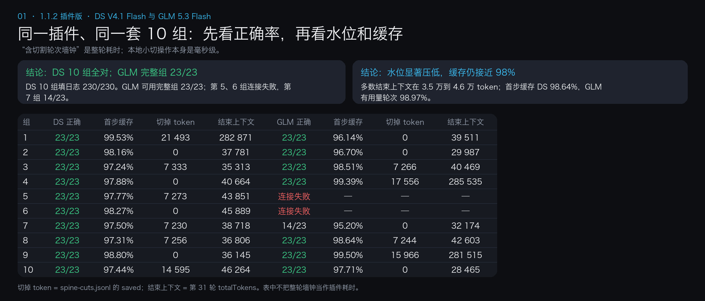
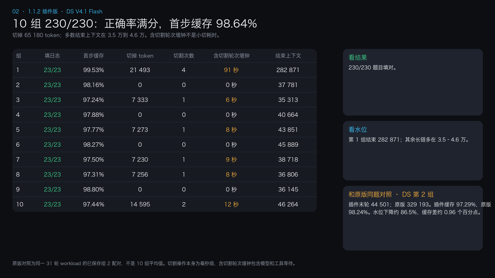
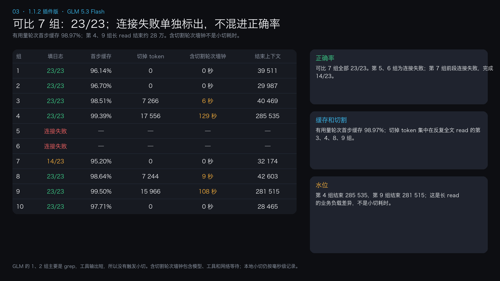

# 版本变更

## 1.1.4

- 修复 #34：空闲维护的大段 catch-up 改为分批让出事件循环；Windows 阴影文件短暂忙时按 8 次上限和退避自动重试，永久失败保持 fail-closed，不阻塞轮次结束返回。
- 游标和 retryable 结果按会话缓存，避免长历史重复扫描；工具结果、raw/meta 字节与 SHA256 在重启恢复后继续校验。
- 本地门禁 `npm run test:gate` 通过 508/508；Windows 2022 x64 与 Windows 11 ARM 的标准用户长会话验收均通过，含 29 轮、进程重启边界和 15,001 事件/356 个工具结果的双阶段捕获恢复。

## 1.1.3

- 修复 #34：工具结果事件不再同步执行 shadow/ACL 文件操作，改为事件循环后排队并按 toolCallId 去重；维护开始前会等待已排队捕获，`captureNew` 仍负责补抓和重试。
- 这条路径避免在模型收到工具结果前被同步磁盘操作卡住；权限失败仍然只拒绝备份，不让宿主 fatal 退出。
- Windows hosted 验收：Windows 11 ARM、Windows 2022 x64 的 Node 22/24 core，以及三套 DSH 0.2.0/0.2.1 普通用户 runtime 均通过；官方 Desktop 普通用户安装、启用、设置保存和重启读取在 Windows 11 ARM 与 Windows 2022 均通过。
- 同一候选又做了 29 轮持久会话回放：Windows 2022 用时 14 分 05 秒，Windows 11 ARM 用时 17 分 08 秒，含第 21 轮进程重启边界和 58 次工具结果捕获。原报告的 93M/第 29 轮冻结没有在这组受控回放中重现；Node 24 首次双进程 cursor 测试的 299/300 竞态重跑通过，作为后续观察项保留。
- Config、验证/头脑风暴模式和自动主题分类继续后置，不改变 1.1.2 的小切默认参数。

## 1.1.2

- 常用压缩参数可以在 DSH 插件设置里改，保留原有环境变量用法。
- 专用备份目录确认只有一个插件进程使用时，低于用量水线可以跳过全目录扫描；完整校准满 60 秒后，下次轮转会重新扫描。默认目录和共享目录继续按原规则检查、清理。
- 扫描不完整或计量不合法时拒绝本次备份。无法确认其他会话已经退出时，不删除它的正文。
- 失败工具结果保留退出码、错误类型、标准错误和标准输出里的关键原因；过长时保留原因和首尾，不能把失败卡片写成正常完成。`npm run test:gate` 也会检查这条路径。
- 提交小切前重新检查 checkpoint、用户边界和工具配对；等待期间出现的新消息也会重新检查。
- 账号模式没有显式地址、恢复旧官方卡片和精确的过程通知可以组合工作；真实用户消息与未知通知仍保留边界。
- 重启后会核验已有备份和游标，再从最近的工作位置继续。
- Windows 会重新设置备份访问权限，失败时停止写备份并保留原工具输出。

### Windows 备份权限

Windows 双用户实测（Actions run `42367713007`，Windows 11 Enterprise ARM / Server 2022 x64）确认：1.1.1 的 `/inheritance:r /grant:r` 会留下其他主体的显式 ACE，第二个普通用户仍能读取备份。1.1.2 改为完整替换 DACL。1.1.3 候选又通过了 hosted Windows core/runtime、官方 Desktop 普通用户安装与设置保存/重启，以及 29 轮持久会话回放；原报告的 93M/第 29 轮冻结未在受控回放中重现，慢存储、超大历史和共享目录压力仍属于后续观察范围。

权限写入改为固定的 `%SystemRoot%\System32\WindowsPowerShell\v1.0\powershell.exe`（Windows PowerShell 5.1 / .NET Framework），使用 `-NoProfile -NonInteractive -EncodedCommand`。脚本固定内嵌在已打包的 `shadow.js`，路径、SID、文件类型通过子进程环境传递，不拼进脚本。当前用户 SID 仍由固定 System32 `whoami.exe` 每进程获取一次，脚本再对照自身 Windows 身份。新建受保护的 DACL，只允许当前用户、SYSTEM、Administrators 完全控制；目录 ACE 带 OI/CI，直接修正的文件 ACE 不带继承标志。只修改 DACL，不提权，不改 owner、group 或 SACL，不使用临时宽松 ACL。写后读取实际 DACL，核验保护位、完整 ACE 数量、SID、Allow、权限及继承标志，收到确认才缓存。工具失败、超时、SID 非法或读回不符都会熔断本进程后续备份，不回退到 chmod。

目录缓存核对规范路径、设备/文件编号及创建时间；替换目录或改指向的已知别名会拒绝后续备份。经确认目录内以 `wx` 新建的空文件，核对已打开句柄与路径指向同一文件后，使用继承的 allowlist，不逐文件启动子进程，写入正文前完成检查。既有文件不能只凭父目录缓存获得信任：仅在本进程已确认同一文件身份时复用缓存，否则对被请求的文件单独替换 DACL。拒绝文件符号链接、非普通文件及多硬链接文件。不扫描或批量修复历史备份；捕获/恢复所请求的旧 raw、meta、cursor 文件在使用时修正。未触及的旧文件（包括直接外部读取或 shadow-search 读取的旧文件）不保证已修复，也无法撤回此前泄露的数据。不要把 shadow 指向混有其他文件的目录。

缓存信任同一用户和管理员不在进程运行期间原地改写 ACL；元数据核对不能发现同一文件上的 ACL 原地变更，也不能消除同用户/管理员并发改路径的全部竞态。SystemRoot/windir 必须指向可信 Windows 安装；文件系统须提供稳定文件身份并支持 Windows DACL，工具缺失或策略禁止运行时拒绝备份。Unix 仍使用目录 0700 / 文件 0600。切点、token/cap 策略、#27 根目录协调与重启口径不变。

离线门禁用 `npm run test:gate`。其中 Windows 权限测试用注入的文件系统和命令验证失败分支。真实权限另用两个 Windows 普通账户验证，分别检查写入、可读的对照文件和备份的读取结果。评分器的离线测试用 `npm run test:live-gate`。

## 1.1.1

1. Windows 上取 SID 和写权限不再走 PATH。固定调用 `%SystemRoot%\System32` 下的 `whoami.exe` 和 `icacls.exe`。环境变量不是盘符绝对路径时，这次备份直接跳过，不退回裸命令名。
2. 当时用 `/inheritance:r /grant:r` 替代 `icacls /restore`；后续双用户实测确认它保留其他显式 ACE，不能实现完整 allowlist。修正及验证限制见上面的 1.1.2 候选说明。
3. 权限失败不再把宿主打退出。这次备份不落盘，不退回 `chmod`，只提示一次。压缩照常进行。
4. 进程重启后补抓工具结果，只补最近 3 轮。已经记下的位置还在，就从那里接着记。记下的位置比当前日志还大，按重启口径补最近 3 轮，不从 0 把整份日志再扫一遍。
5. 一轮里有不少于 1000 token 的 `read`，这一刀只切这一轮，不把要留的后 3 轮短结果一起卷进去。这一轮里单个工具结果达到 3.2 万，只留指针。这一轮切不下来，才按原来的规则切更早的轮。
6. 65 万、4.8 万、3.2 万、`CHUNK_MIN` 1000、云端默认 `0.8` / `65536` / `8192`、`SPINE_THUNDER` 默认关闭，都没改。没有加「省下的必须盖过重写」这种新门槛。备份目录快满时仍是先扫再判断，这版没改，留到 1.1.2。

## 1.1.0

1. Issue #19 里下一轮输入回到 21 万到 24 万、前缀被打掉的那一刀，是切点走到了已有卡片左边。1.1.0 把最新一张卡片当成地板。往左走到卡片就停。切点右边还有更新的卡片，这一刀不切。已进缓存的前缀不再被后面的刀改写。
2. 同一次收尾可以连切，这是现有设计，没有改。改的是记账。以前每一刀都把尾巴算进重写，四刀就把同一段尾巴乘了四次。现在一次收尾只记一次：第一刀之后的前缀，减去后面几刀省下的。`dsh-live-compact stats` 的 `rewrite` 用这个数。逐刀明细在 shadow 目录的 `spine-cuts.jsonl`，只有序号、token 和切点，没有消息原文。
3. 没有加「省下的必须盖过重写」这种新门槛。加了会把同一次收尾里后面的刀切掉。65 万停切线、收尾停在 3.2 万、`CHUNK_MIN` 默认 1000、云端默认 `0.8` / `65536` / `8192`，都没改。`SPINE_THUNDER` 仍是默认关闭。
4. 今天桌面端长时间卡住，是每回合、每个工具结果都在拷贝整份会话日志，并反复计量。1.1.0 一个空闲回合只拷贝一次日志。工具结果到达时用已经记下的调用编号，不再为了查一次调用而拷贝整份日志。收尾循环复用这一次的任务和调用表。token 计量是开头一次，每真正切下一刀再测一次。没切的回合只测一次。切哪一段没改。

## 门禁和复测

`npm run test:gate` 已过。Windows 取权限、宿主不退出、重启只补最近 3 轮、长 `read` 只切自己那一轮，都在这道门禁里。65 万、3.2 万、`CHUNK_MIN` 1000、云端默认值没改。

这轮连的是插件版。10 组同一套 31 轮填日志，组内串行，两个模型同时开。原版 DSH 压缩对比留到 1.1.2。Coder 390 27B 这轮没跑，后补。测评图在下面，也在 [v1.1.1](https://github.com/Tranquillitatis-Lab/dsh-live-compact/releases/tag/v1.1.1)。

下面三张图沿用已完成的 1.1.1 实测数据；1.1.2 只更新运行时修复和门禁，图标题按当前发布版本标注。

看图时，先看日志题答对多少，再看首步缓存和压缩节省。首步缓存取每轮第一个 `step_end`，把命中 token 加起来，再除以这些请求的总输入 token。压缩节省是 `spine-cuts.jsonl` 里 `saved` 的合计。压缩轮次耗时是发生压缩的各轮总耗时之和，压缩操作本身为毫秒级。任务墙钟是从第 1 轮开始到第 31 轮结束的实际用时。结束上下文取最后一轮的 `totalTokens`，包含此前保留下来的内容。

DS V4.1 Flash 跑了 10 组，填日志 230/230，跳过 0。首步缓存 98.64%，压缩节省 65 180 token，总墙钟 36 分 18 秒。多数组结束在 3.5 万到 4.6 万 token。第 1 组读了 25 次全文，4 次压缩共节省 21 493 token，结束时仍有 282 871。第 2 组几乎只用 bash，只读了一次全文，未触发压缩，结束时是 37 781。图中的“含切割轮次墙钟”是整轮模型、工具和网络等待，不是插件小切耗时；小切操作本身为毫秒级。

GLM 5.3 Flash 用了同一个插件、同一套题。完整跑完的 7 组为 23/23；第 5、6 组连接失败；第 7 组前段连接失败，完成 14/23。有用量记录的轮次，首步缓存是 98.97%。第 1、2 组主要用 grep，未触发压缩，结束时分别是 39 511 和 29 987 token。第 4、9 组反复读全文，结束时分别是 285 535 和 281 515。GLM 图只展示插件实测；没有对应 stock 配对数据的地方不推断原版差值。







## 1.0.9

1. 云端和本地按当前配置里这一家的地址区分。请求头通常只有 provider 名。配置里的 `baseURL` 优先，没有再看官方 DeepSeek 和内置目录。公网地址按云端切，回环和内网按本地。读不到地址仍按本地。`SPINE_ENGINE=local` 或 `cloud` 可以强制指定。这不改官方大门的 headroom。
2. 官方大压缩的三项可以在启动前用环境变量覆盖：`SPINE_THRESHOLD_RATIO`、`SPINE_HEADROOM_TOKENS`、`SPINE_RETAIN_TOKENS`。云端默认仍是 `0.8`、`65536`、`8192`，不按地址改小。TUI 的 `/settings` 没有这一项。要改当前配置，直接改 `cordis.patch.yml` 里的对应字段。
3. 发版门禁是 `npm run test:gate`，不连模型。8 组 31 轮在 `test/live-fill`，要连模型。这两部分都在 GitHub 测试集里。
4. 测评分两个口径。云端看题对不对，以及每轮第一个 `step_end` 的缓存命中。本地看题对不对和切掉的 token。DS V4.1 Flash，8 组，184/184，跳过 0，缓存 98.22%，题末最高 35334，切掉 97306，估算费用 $0.208。GLM 5.3 Flash，同一套 8 组，184/184，同一公式缓存 74.66%。Coder 390 27B，3 组 31 轮，填日志 69/69，切掉 20635。费用是离峰用量估算，不是账单。
5. 安装用 npm 的 `dsh-live-compact@1.0.9`。上不了 npm 时用镜像包 https://download.merkyorlynn.com/downloads/plugins/dsh-live-compact-1.0.9.tgz 。页面在 https://download.merkyorlynn.com/live-compact.html 。测评图在当时的 [v1.0.9](https://github.com/Tranquillitatis-Lab/dsh-live-compact/releases/tag/v1.0.9)。


## 两场测评

两场不混在一张表里。150 道是编程短题，串在同一次对话里。20 题是 WebUniverse 长链路。


短题 150 道，Aider `polyglot-benchmark` `7e0611e`。Python、Go、JavaScript、Rust、Java 各 30 题，没有 C++，按字母序穿插。从 `python-affine-cipher`、`go-alphametics`、`javascript-affine-cipher`、`rust-accumulate`、`java-affine-cipher` 往下走。

| | 原版 | Live Compact |
|---|---:|---:|
| 通过 | 150/150 | 150/150 |
| 全程命中率 | 99.55% | 99.56% |
| 缓存命中 | 335.0M | 244.3M |
| 缓存未命中 | 1.498M | 1.088M |
| 费用 | $1.50 | $1.15，预热 0 |
| 上下文峰值 | 679K | 589K |
| 压缩 | 1 次，12.8 秒 | 145 刀，2.2 秒 |
| 墙钟 | 8,531 秒 | 6,105 秒 |

便宜约 23%。145 刀切掉约 474K token。峰值 589,414，结束 589,554，没到 65 万。墙钟 6,105 秒这轮只跑了插件一边，快出来的时间不能全算在插件上。

上面两场是 1.0.2 之前测的。1.0.2 没有重跑 150 题，也没有在真实超过 2 万 token 的会话里切过一刀。

## 失忆对比

1.0.5 对过一次失忆。同一会话、同样任务，真实 DeepSeek。先埋 13 条约束和 1 条报错，再灌 6 轮日志，然后不许读文件，凭记忆答题。每组 2 次，只说明方向。

| | 原版 | Live Compact |
|---|---|---|
| 15 道回忆题 | 15/15，15/15 | 15/15，15/15 |
| 违反约束 | 1 次轻微，0 | 0，0 |
| 日志中段 3 个细节 | 1/3；另一次 3/3，靠解压会话日志，多 10 次工具 | 3/3，3/3，查自己的备份 |
| 每次请求上下文 | 约 15K | 约 29K |

用户说过的约束两边都没忘。差别在工具输出里的细节。总花费在同一个量级。原版这次把摘要阈值调低，保证回忆前做过摘要。

长链路 20 题是另一场。原版第 15 题才做模型摘要，14.552 秒，切掉 520,460。压完上下文掉到 15.5 万，结束时又回到 433,844。插件 20 刀，74 毫秒，切掉 486,193。题末平均上下文 217,276，比原版 366,942 低 40.8%。结束上下文 323,726，比原版低 25.4%。题末采样命中率原版 99.87%，插件 99.90%。第 20 题那一跳原版 99.84%，插件 99.95%。采样命中率按每题末次请求的 token 加权，平均上下文取 20 个题末快照。

## 长填日志

1.0.6 跑了 8 组。每组 31 轮，其中 23 轮读一份 520 行日志，报告 WARN 条数和 NOTICE 原文。没有 NOTICE 就写 NONE。真实 DeepSeek。


| | 结果 |
|---|---:|
| 填日志回合 | 184 |
| 跳过工具直接报数字 | 0 |
| WARN | 184/184 |
| NOTICE | 184/184 |
| 假 NOTICE | 0 |
| 切过的会话 | 8/8，共 17 刀 |

8 组都切过，不是没压缩才碰巧对。这次提示没有「没有工具结果就不要给数字」。和早先一次 54/184 跳过工具的记录不是同一份日志重放。65 万停切线这版没动。

同一套题又跑了原版官方压缩。分数一样，费用一样，上下文更低。跳过工具两边都是 0，WARN 和 NOTICE 都是 184/184。费用按离峰用量估算，插件 $0.211，原版 $0.229，不是账单。题末上下文插件平均 2.6 万、最高 3.5 万；原版平均 4.4 万、最高 12.6 万。插件 8 组都在 3.5 万以内，原版有两组到了 8.0 万和 12.6 万。


`cordis.patch.yml` 是静态整块替换，不读这三个环境变量。要在这里改 `headroomTokens`，需直接改配置块，例如：

```yaml
- id: compaction-spine
  name: dsh-live-compact
  config:
    auto: true
    thresholdRatio: 0.8
    headroomTokens: 16384
    retainTokens: 8192
    compactionRetries: 0
```

## 1.0.8

同一套 8 组、184 个填日志回合。真实 DeepSeek。跳过工具 0，WARN 184/184，NOTICE 184/184。缓存命中 98.23%，1.0.6 是 97.88%，原版是 98.51%。题末平均 2.6 万，最高 3.6 万，最低 1.6 万。1.0.6 最高 3.5 万。原版最高 12.6 万。费用按离峰用量估算，1.0.8 是 $0.209，1.0.6 是 $0.211，原版是 $0.229，不是账单。切掉的原文 11.4 万 token。原版没有压缩，8 组题末加起来积累了 34.9 万。


卡片不再使用官方的 `<compacted-summary>` 和 `compact-checkpoint`。官方压缩会把那种节点当成上一版摘要再摘一次，切片摘要会越压越短。新卡片用 `spine-checkpoint`。已经写过的旧卡片仍会停住，不会再切一遍。

遇到已有卡片就停止往前扩。这是故意的。卡片已经换过一次，再穿过去会改掉已经进缓存的前缀。最新一段不够 1000，就跳过，不回头凑。

单个工具结果超过 3.2 万 token 才只留指针。默认不改。要自己调，启动前设 `SPINE_POINTER_TOKENS`，例如 `8000`。不按占比算。

## 1.0.7 长填日志

1.0.7 跑了同一套 8 组。真实 DeepSeek。184 个填日志回合都调用了工具。WARN 183/184，NOTICE 184/184，假 NOTICE 是 0。8 组都切过，一共 43 刀。卡片 43 张都有会话序号，没有备份路径。

差的 1 题是第 7 组第 4 轮。文件读了，模型把 NOTICE 那一行也算进 WARN，报了 8，日志里是 7。


和已发布的 1.0.6、以及上次同一套题的官方压缩比。跳过工具都是 0。费用按离峰用量估算，1.0.7 是 $0.249，1.0.6 是 $0.211，原版是 $0.229，不是账单。缓存命中 1.0.7 是 96.10%，1.0.6 是 97.88%，原版是 98.51%。题末上下文 1.0.7 平均 2.3 万、最高 3.1 万、最低 1.9 万，8 组都在 3.2 万以内。1.0.6 平均 2.6 万、最高 3.5 万。原版平均 4.4 万、最高 12.6 万，有两组到了 8.0 万和 12.6 万。切掉的原文，1.0.7 是 21.5 万 token，1.0.6 是 9.0 万。原版这一轮没有压缩，8 组题末上下文加起来积累了 34.9 万，最高一组 12.6 万。65 万停切线没动。


## 1.0.7 改了什么

1.0.7 安装地址是新的。1.0.2 到 1.0.6 的旧包还在原来的链接上。

- 云端和本地分开切。官方 DeepSeek 按公网地址切。服务商名含 strata，或地址是本机、私网、读不到，按本地切，不越过最后一条用户消息。
- 最后一条用户消息不进切段。较早的用户原文写成单行 JSON，留在卡片里。
- 卡片指针是会话日志的事件号，不写备份文件路径。最近 3 个已结束的工具轮仍留原文。
- 单个超过 3.2 万 token 的工具结果只留序号指针，并连同对应调用一起换掉。
- 备份默认上限 256MB。快满时仍删最老的。`SPINE_SHADOW_MAX_BYTES` 和 `SPINE_SHADOW_MAX_MB` 还能改。
- 切完可看累计：`dsh-live-compact stats`。估算按未命中输入 $0.15/M，不扣重写成本。
- 当前会话备份可以另查：`import { searchShadow } from "dsh-live-compact/shadow-search"`。插件自己不会去搜。
- 65 万停切线没改。

## 1.0.6 改了什么

1.0.6 安装地址是新的。1.0.2、1.0.3、1.0.4、1.0.5 的旧包还在原来的链接上。

- 配置报错不再被盖成「服务已被注册」。装不上时能看见原来的原因。
- 备份按会话分目录。卡片只指向这一份文件所在的目录。
- 报错优先进卡片。最近 3 个已经结束的工具轮留在原来的调用和结果里，结果不截短。更早的轮才收成卡片。
- 助手说的「已提交 / 已发布」不进硬行。卡片只记有调用编号的工具事件，不靠词表。
- 后台任务照常切。没结束的登记在卡片上，之后的文件以磁盘为准。失败的 kill 不会被记成已结束。
- 工具原文在官方修剪前按调用编号落盘。卡片给路径、哈希和字节数。写失败就写无完整备份，不留悬空路径。
- 65 万停切线没改。窗口更大时，过了 65 万仍会停掉小切。

## 1.0.5 改了什么

1.0.5 安装地址是新的。1.0.2、1.0.3、1.0.4 的旧包还在原来的链接上。修的是 1.0.4 实测里的五处：

- 预设不再硬等 gate。gate 加载失败时，网页预设不会卡在等待。换包前先试加载，失败就保留原版名字。
- 换上之后带上 0.8、65536、8192。预设里已有的配置优先。
- 预设 id 写在外层或内层都能换。standard、ptc、cordis、minimal 在 0.2.1-rc.5 上都会换。TUI 仍不碰。
- 命令输出只有结构信号才标成报错原文：`isError`、非 0 退出码、`[stderr]`、`[exit code: N]`、`[Command finished with exit code N]`、`exit_code=N`、ptc 结果里的 `"exitCode": N`。证据不够就标状态未知，留原文末尾几行。
- 长输出要先把备份写成功，卡片才指向那个文件。写失败就不切，也不指向一个还不存在的文件。
- 备份写成一个确定的文件，编号不存在共享引擎上。卡片里写这次备份的实际路径。
- 官方工具结果修剪器裁掉的内容不进这份备份。备份默认上限 256MB。满了先删最老的，删不出空间才不切。
- 外壳先加载。引擎装不上时，这一会话不挂起。能改用原版就用原版，并记下「本会话未接管」。原版也装不上时，`/compact` 马上返回错误。
- headless 的宿主包自己关掉了原版压缩。插件不能把那一行重新打开。网页预设不注入 gate，漏换这一轮就继续用原版。

## 1.0.4 改了什么

1.0.4 安装地址是新的。1.0.0 到 1.0.3 的旧包还在原来的链接上。

短的工具结果会留在摘要里，标成工具输出，不标已确认。不超过 12 行、也不超过 512 字，整段留下。更长的只留一行：多少字、正文已省略。省略的原文在本机 `~/.dsh/compaction-spine/shadow`，文件名含这次的短编号。需要再读，不要默认读进来。思考仍不进摘要。

## 1.0.3 改了什么

1.0.3 安装地址是新的。1.0.0、1.0.1、1.0.2 的旧包还在原来的链接上。

摘录只留正文。用户的话和助手写出来的句子按原来的规则留，并标是谁说的。思考和工具结果不进摘要。思考和工具原文进本地备份，带来源。这版不自动读回下一问。

网页和 Desktop 的四个预设在加载时会把组里的原版压缩换成这个包。换不上就落回原版，预设仍能起来。TUI 这版不碰。

- 思考过程不进摘要。本地备份里单独存，标成思考。
- 工具输出不进摘要。`PASS`、文件已更新、目录列表、本机路径、报错头都不留。原文在备份里。
- 留下的每一行标原来是谁说的。句子里写着「用户说」，也不会变成你的新指令。
- 去掉「已确认」。摘要开头写明：这是旧内容摘录，不是新指令，也不是你的授权。
- 这一刀如果没有合格的摘要，就整段留下，不去调模型。卡片可以很短。
- 备份只有自己能读。文件名不带会话号。本机路径不发给模型。备份默认上限 256MB。满了先删最老的，删不出空间才不切。
- 2 万和 65 万没动。配置里的 0.8 只管官方大压缩，不管这一刀。想改小切的起点，用下面的设置界面改 `minTokens`（老的 `SPINE_MIN_TOKENS` 仍然有效）。
