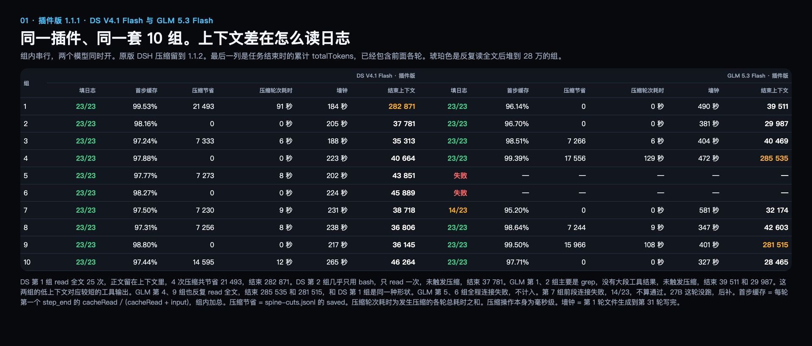
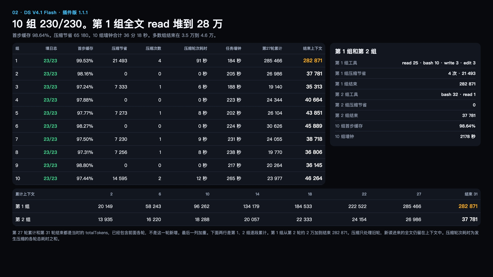
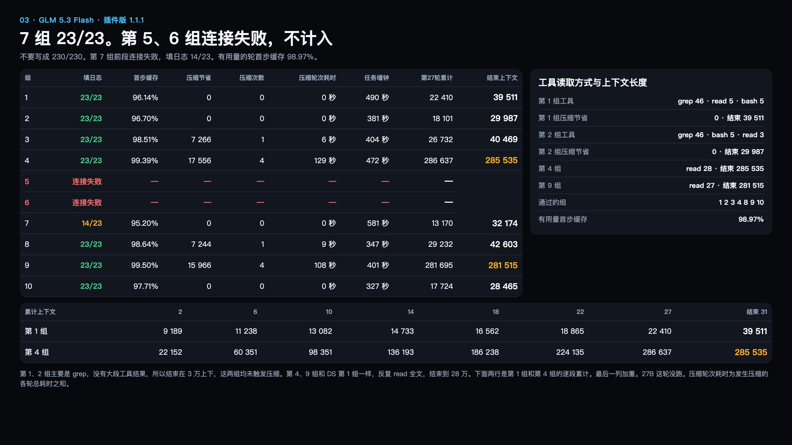

# 边做边压 Live Compact

一段对话做久了，读过的日志、跑过的命令和工具输出会越积越多。Live Compact 会在每轮结束时检查，能安全收短的长输出就整理一下。这一步在本机做，无需再请求模型。只替换选中的一段，切点前面的内容保持原样。整理前会备份原文，备份失败就保留原来的内容。

## 云端和本地怎么用

- **用 DeepSeek、GLM 这类云端 API**，按下面的命令安装即可。先看答案是否正确，再一起看缓存命中、未命中输入和实际费用。命中率的百分比不是费用本身，输入变少时要连同 token 数一起比较。
- **用本机或内网跑的模型**，同样按下面的命令安装。优先看答案对不对、当前上下文有没有降低、实际少了多少 token。界面显示「上下文 2 万多」是还留着的内容量，不是没有压缩。本地缓存复用也会尽量改善，但不套云端计费缓存的固定命中率门槛；同一任务前后还可以比较复用量和预填充耗时。

默认到 2 万 token，插件才开始检查有没有合适的内容可以压缩。实际会不会压缩，还要看这轮读进了什么、下一轮可能有多长。上下文接近窗口上限时，DSH 仍可调用模型做一次大摘要。

平常用默认设置就够了。`SPINE_THUNDER` 是实验性的模型摘要模式，默认关闭。需要试用时才设为 `1`。本机或内网模型建议保持关闭。

headless：

```sh
dsh plugin --profile headless add dsh-live-compact@1.1.2
```

网页端：

```sh
dsh plugin --profile web add dsh-live-compact@1.1.2
```

想先装到本机看版本：

```sh
npm install -g dsh-live-compact
dsh-live-compact --version
```

## 1.1.2

- 常用压缩参数可以在 DSH 插件设置里改，保留原有环境变量用法。
- 专用备份目录确认只有一个插件进程使用时，低于用量水线可以跳过全目录扫描；完整校准满 60 秒后，下次轮转会重新扫描。默认目录和共享目录继续按原规则检查、清理。
- 扫描不完整或计量不合法时拒绝本次备份。无法确认其他会话已经退出时，不删除它的正文。
- 提交小切前重新检查 checkpoint、用户边界和工具配对；等待期间出现的新消息也会重新检查。
- 账号模式没有显式地址、恢复旧官方卡片和精确的过程通知可以组合工作；真实用户消息与未知通知仍保留边界。
- 重启后会核验已有备份和游标，再从最近的工作位置继续。
- Windows 会重新设置备份访问权限，失败时停止写备份并保留原工具输出。

### Windows 备份权限

Windows 双用户实测（Actions run `42367713007`，Windows 11 Enterprise ARM / Server 2022 x64）确认：1.1.1 的 `/inheritance:r /grant:r` 会留下其他主体的显式 ACE，第二个普通用户仍能读取备份。1.1.2 改为完整替换 DACL。本次运行时代码修改后，最终候选仍须重新完成原生 Windows 与 Desktop 验收，结果随最终候选记录。

权限写入改为固定的 `%SystemRoot%\System32\WindowsPowerShell\v1.0\powershell.exe`（Windows PowerShell 5.1 / .NET Framework），使用 `-NoProfile -NonInteractive -EncodedCommand`。脚本固定内嵌在已打包的 `shadow.js`，路径、SID、文件类型通过子进程环境传递，不拼进脚本。当前用户 SID 仍由固定 System32 `whoami.exe` 每进程获取一次，脚本再对照自身 Windows 身份。新建受保护的 DACL，只允许当前用户、SYSTEM、Administrators 完全控制；目录 ACE 带 OI/CI，直接修正的文件 ACE 不带继承标志。只修改 DACL，不提权，不改 owner、group 或 SACL，不使用临时宽松 ACL。写后读取实际 DACL，核验保护位、完整 ACE 数量、SID、Allow、权限及继承标志，收到确认才缓存。工具失败、超时、SID 非法或读回不符都会熔断本进程后续备份，不回退到 chmod。

目录缓存核对规范路径、设备/文件编号及创建时间；替换目录或改指向的已知别名会拒绝后续备份。经确认目录内以 `wx` 新建的空文件，核对已打开句柄与路径指向同一文件后，使用继承的 allowlist，不逐文件启动子进程，写入正文前完成检查。既有文件不能只凭父目录缓存获得信任：仅在本进程已确认同一文件身份时复用缓存，否则对被请求的文件单独替换 DACL。拒绝文件符号链接、非普通文件及多硬链接文件。不扫描或批量修复历史备份；捕获/恢复所请求的旧 raw、meta、cursor 文件在使用时修正。未触及的旧文件（包括直接外部读取或 shadow-search 读取的旧文件）不保证已修复，也无法撤回此前泄露的数据。不要把 shadow 指向混有其他文件的目录。

缓存信任同一用户和管理员不在进程运行期间原地改写 ACL；元数据核对不能发现同一文件上的 ACL 原地变更，也不能消除同用户/管理员并发改路径的全部竞态。SystemRoot/windir 必须指向可信 Windows 安装；文件系统须提供稳定文件身份并支持 Windows DACL，工具缺失或策略禁止运行时拒绝备份。Unix 仍使用目录 0700 / 文件 0600。切点、token/cap 策略、#27 根目录协调与重启口径不变。

离线门禁用 `npm run test:gate`。其中 Windows 权限测试用注入的文件系统和命令验证失败分支。真实权限另用两个 Windows 普通账户验证，分别检查写入、可读的对照文件和备份的读取结果。评分器的离线测试用 `npm run test:live-gate`。

## 1.1.1

1. Windows 上取 SID 和写权限不再走 PATH。固定调用 `%SystemRoot%\System32` 下的 `whoami.exe` 和 `icacls.exe`。环境变量不是盘符绝对路径时，这次备份直接跳过，不退回裸命令名。
2. 当时用 `/inheritance:r /grant:r` 替代 `icacls /restore`；后续双用户实测确认它保留其他显式 ACE，不能实现完整 allowlist。修正及验证限制见上面的 1.1.2 候选说明。
3. 权限失败不再把宿主打退出。这次备份不落盘，不退回 `chmod`，只提示一次。压缩照常进行。
4. 进程重启后补抓工具结果，只补最近 3 轮。已经记下的位置还在，就从那里接着记。记下的位置比当前日志还大，按重启口径补最近 3 轮，不从 0 把整份日志再扫一遍。
5. 一轮里有不少于 1000 token 的 `read`，这一刀只切这一轮，不把要留的后 3 轮短结果一起卷进去。这一轮里单个工具结果达到 3.2 万，只留指针。这一轮切不下来，才按原来的规则切更早的轮。
6. 65 万、4.8 万、3.2 万、`CHUNK_MIN` 1000、云端默认 `0.8` / `65536` / `8192`、`SPINE_THUNDER` 默认关闭，都没改。没有加「省下的必须盖过重写」这种新门槛。备份目录快满时仍是先扫再判断，这版没改，留到 1.1.2。

## 1.1.0

1. Issue #19 里下一轮输入回到 21 万到 24 万、前缀被打掉的那一刀，是切点走到了已有卡片左边。1.1.0 把最新一张卡片当成地板。往左走到卡片就停。切点右边还有更新的卡片，这一刀不切。已进缓存的前缀不再被后面的刀改写。
2. 同一次收尾可以连切，这是现有设计，没有改。改的是记账。以前每一刀都把尾巴算进重写，四刀就把同一段尾巴乘了四次。现在一次收尾只记一次：第一刀之后的前缀，减去后面几刀省下的。`dsh-live-compact stats` 的 `rewrite` 用这个数。逐刀明细在 shadow 目录的 `spine-cuts.jsonl`，只有序号、token 和切点，没有消息原文。
3. 没有加「省下的必须盖过重写」这种新门槛。加了会把同一次收尾里后面的刀切掉。65 万停切线、收尾停在 3.2 万、`CHUNK_MIN` 默认 1000、云端默认 `0.8` / `65536` / `8192`，都没改。`SPINE_THUNDER` 仍是默认关闭。
4. 今天桌面端长时间卡住，是每回合、每个工具结果都在拷贝整份会话日志，并反复计量。1.1.0 一个空闲回合只拷贝一次日志。工具结果到达时用已经记下的调用编号，不再为了查一次调用而拷贝整份日志。收尾循环复用这一次的任务和调用表。token 计量是开头一次，每真正切下一刀再测一次。没切的回合只测一次。切哪一段没改。

## 门禁和复测

`npm run test:gate` 已过。Windows 取权限、宿主不退出、重启只补最近 3 轮、长 `read` 只切自己那一轮，都在这道门禁里。65 万、3.2 万、`CHUNK_MIN` 1000、云端默认值没改。

这轮连的是插件版。10 组同一套 31 轮填日志，组内串行，两个模型同时开。原版 DSH 压缩对比留到 1.1.2。Coder 390 27B 这轮没跑，后补。测评图在下面，也在 [v1.1.1](https://github.com/Tranquillitatis-Lab/dsh-live-compact/releases/tag/v1.1.1)。

看图时，先看日志题答对多少，再看首步缓存和压缩节省。首步缓存取每轮第一个 `step_end`，把命中 token 加起来，再除以这些请求的总输入 token。压缩节省是 `spine-cuts.jsonl` 里 `saved` 的合计。压缩轮次耗时是发生压缩的各轮总耗时之和，压缩操作本身为毫秒级。任务墙钟是从第 1 轮开始到第 31 轮结束的实际用时。结束上下文取最后一轮的 `totalTokens`，包含此前保留下来的内容。

DS V4.1 Flash 跑了 10 组，填日志 230/230，跳过 0。首步缓存 98.64%，压缩节省 65 180 token，总用时 36 分 18 秒。多数组结束在 3.5 万到 4.6 万 token。第 1 组读了 25 次全文，4 次压缩共节省 21 493 token，结束时仍有 282 871。第 2 组几乎只用 bash，只读了一次全文，未触发压缩，结束时是 37 781。

GLM 5.3 Flash 用了同一个插件、同一套题。有 7 组填日志达到 23/23。第 5、6 组全程连接失败。第 7 组前段连接失败，完成 14/23。有用量记录的轮次，首步缓存是 98.97%。第 1、2 组主要用 grep，未触发压缩，结束时分别是 39 511 和 29 987 token。第 4、9 组反复读全文，结束时分别是 285 535 和 281 515，和 DS 第 1 组很像。可比的 7 组里，DS 每组都更快。







## 1.0.9

1. 云端和本地按当前配置里这一家的地址区分。请求头通常只有 provider 名。配置里的 `baseURL` 优先，没有再看官方 DeepSeek 和内置目录。公网地址按云端切，回环和内网按本地。读不到地址仍按本地。`SPINE_ENGINE=local` 或 `cloud` 可以强制指定。这不改官方大门的 headroom。
2. 官方大压缩的三项可以在启动前用环境变量覆盖：`SPINE_THRESHOLD_RATIO`、`SPINE_HEADROOM_TOKENS`、`SPINE_RETAIN_TOKENS`。云端默认仍是 `0.8`、`65536`、`8192`，不按地址改小。TUI 的 `/settings` 没有这一项。要改当前配置，直接改 `cordis.patch.yml` 里的对应字段。
3. 发版门禁是 `npm run test:gate`，不连模型。8 组 31 轮在 `test/live-fill`，要连模型。这两部分都在 GitHub 测试集里。
4. 测评分两个口径。云端看题对不对，以及每轮第一个 `step_end` 的缓存命中。本地看题对不对和切掉的 token。DS V4.1 Flash，8 组，184/184，跳过 0，缓存 98.22%，题末最高 35334，切掉 97306，估算费用 $0.208。GLM 5.3 Flash，同一套 8 组，184/184，同一公式缓存 74.66%。Coder 390 27B，3 组 31 轮，填日志 69/69，切掉 20635。费用是离峰用量估算，不是账单。
5. 安装用 npm 的 `dsh-live-compact@1.0.9`。上不了 npm 时用镜像包 https://download.merkyorlynn.com/downloads/plugins/dsh-live-compact-1.0.9.tgz 。页面在 https://download.merkyorlynn.com/live-compact.html 。测评图在当时的 [v1.0.9](https://github.com/Tranquillitatis-Lab/dsh-live-compact/releases/tag/v1.0.9)。


## 两场测评

两场不混在一张表里。150 道是编程短题，串在同一次对话里。20 题是 WebUniverse 长链路。


短题 150 道，Aider `polyglot-benchmark` `7e0611e`。Python、Go、JavaScript、Rust、Java 各 30 题，没有 C++，按字母序穿插。从 `python-affine-cipher`、`go-alphametics`、`javascript-affine-cipher`、`rust-accumulate`、`java-affine-cipher` 往下走。

| | 原版 | Live Compact |
|---|---:|---:|
| 通过 | 150/150 | 150/150 |
| 全程命中率 | 99.55% | 99.56% |
| 缓存命中 | 335.0M | 244.3M |
| 缓存未命中 | 1.498M | 1.088M |
| 费用 | $1.50 | $1.15，预热 0 |
| 上下文峰值 | 679K | 589K |
| 压缩 | 1 次，12.8 秒 | 145 刀，2.2 秒 |
| 墙钟 | 8,531 秒 | 6,105 秒 |

便宜约 23%。145 刀切掉约 474K token。峰值 589,414，结束 589,554，没到 65 万。墙钟 6,105 秒这轮只跑了插件一边，快出来的时间不能全算在插件上。

上面两场是 1.0.2 之前测的。1.0.2 没有重跑 150 题，也没有在真实超过 2 万 token 的会话里切过一刀。

## 失忆对比

1.0.5 对过一次失忆。同一会话、同样任务，真实 DeepSeek。先埋 13 条约束和 1 条报错，再灌 6 轮日志，然后不许读文件，凭记忆答题。每组 2 次，只说明方向。

| | 原版 | Live Compact |
|---|---|---|
| 15 道回忆题 | 15/15，15/15 | 15/15，15/15 |
| 违反约束 | 1 次轻微，0 | 0，0 |
| 日志中段 3 个细节 | 1/3；另一次 3/3，靠解压会话日志，多 10 次工具 | 3/3，3/3，查自己的备份 |
| 每次请求上下文 | 约 15K | 约 29K |

用户说过的约束两边都没忘。差别在工具输出里的细节。总花费在同一个量级。原版这次把摘要阈值调低，保证回忆前做过摘要。

长链路 20 题是另一场。原版第 15 题才做模型摘要，14.552 秒，切掉 520,460。压完上下文掉到 15.5 万，结束时又回到 433,844。插件 20 刀，74 毫秒，切掉 486,193。题末平均上下文 217,276，比原版 366,942 低 40.8%。结束上下文 323,726，比原版低 25.4%。题末采样命中率原版 99.87%，插件 99.90%。第 20 题那一跳原版 99.84%，插件 99.95%。采样命中率按每题末次请求的 token 加权，平均上下文取 20 个题末快照。

## 长填日志

1.0.6 跑了 8 组。每组 31 轮，其中 23 轮读一份 520 行日志，报告 WARN 条数和 NOTICE 原文。没有 NOTICE 就写 NONE。真实 DeepSeek。


| | 结果 |
|---|---:|
| 填日志回合 | 184 |
| 跳过工具直接报数字 | 0 |
| WARN | 184/184 |
| NOTICE | 184/184 |
| 假 NOTICE | 0 |
| 切过的会话 | 8/8，共 17 刀 |

8 组都切过，不是没压缩才碰巧对。这次提示没有「没有工具结果就不要给数字」。和早先一次 54/184 跳过工具的记录不是同一份日志重放。65 万停切线这版没动。

同一套题又跑了原版官方压缩。分数一样，费用一样，上下文更低。跳过工具两边都是 0，WARN 和 NOTICE 都是 184/184。费用按离峰用量估算，插件 $0.211，原版 $0.229，不是账单。题末上下文插件平均 2.6 万、最高 3.5 万；原版平均 4.4 万、最高 12.6 万。插件 8 组都在 3.5 万以内，原版有两组到了 8.0 万和 12.6 万。


`cordis.patch.yml` 是静态整块替换，不读这三个环境变量。要在这里改 `headroomTokens`，需直接改配置块，例如：

```yaml
- id: compaction-spine
  name: dsh-live-compact
  config:
    auto: true
    thresholdRatio: 0.8
    headroomTokens: 16384
    retainTokens: 8192
    compactionRetries: 0
```

## 1.0.8

同一套 8 组、184 个填日志回合。真实 DeepSeek。跳过工具 0，WARN 184/184，NOTICE 184/184。缓存命中 98.23%，1.0.6 是 97.88%，原版是 98.51%。题末平均 2.6 万，最高 3.6 万，最低 1.6 万。1.0.6 最高 3.5 万。原版最高 12.6 万。费用按离峰用量估算，1.0.8 是 $0.209，1.0.6 是 $0.211，原版是 $0.229，不是账单。切掉的原文 11.4 万 token。原版没有压缩，8 组题末加起来积累了 34.9 万。


卡片不再使用官方的 `<compacted-summary>` 和 `compact-checkpoint`。官方压缩会把那种节点当成上一版摘要再摘一次，切片摘要会越压越短。新卡片用 `spine-checkpoint`。已经写过的旧卡片仍会停住，不会再切一遍。

遇到已有卡片就停止往前扩。这是故意的。卡片已经换过一次，再穿过去会改掉已经进缓存的前缀。最新一段不够 1000，就跳过，不回头凑。

单个工具结果超过 3.2 万 token 才只留指针。默认不改。要自己调，启动前设 `SPINE_POINTER_TOKENS`，例如 `8000`。不按占比算。

## 1.0.7 长填日志

1.0.7 跑了同一套 8 组。真实 DeepSeek。184 个填日志回合都调用了工具。WARN 183/184，NOTICE 184/184，假 NOTICE 是 0。8 组都切过，一共 43 刀。卡片 43 张都有会话序号，没有备份路径。

差的 1 题是第 7 组第 4 轮。文件读了，模型把 NOTICE 那一行也算进 WARN，报了 8，日志里是 7。


和已发布的 1.0.6、以及上次同一套题的官方压缩比。跳过工具都是 0。费用按离峰用量估算，1.0.7 是 $0.249，1.0.6 是 $0.211，原版是 $0.229，不是账单。缓存命中 1.0.7 是 96.10%，1.0.6 是 97.88%，原版是 98.51%。题末上下文 1.0.7 平均 2.3 万、最高 3.1 万、最低 1.9 万，8 组都在 3.2 万以内。1.0.6 平均 2.6 万、最高 3.5 万。原版平均 4.4 万、最高 12.6 万，有两组到了 8.0 万和 12.6 万。切掉的原文，1.0.7 是 21.5 万 token，1.0.6 是 9.0 万。原版这一轮没有压缩，8 组题末上下文加起来积累了 34.9 万，最高一组 12.6 万。65 万停切线没动。


## 1.0.7 改了什么

1.0.7 安装地址是新的。1.0.2 到 1.0.6 的旧包还在原来的链接上。

- 云端和本地分开切。官方 DeepSeek 按公网地址切。服务商名含 strata，或地址是本机、私网、读不到，按本地切，不越过最后一条用户消息。
- 最后一条用户消息不进切段。较早的用户原文写成单行 JSON，留在卡片里。
- 卡片指针是会话日志的事件号，不写备份文件路径。最近 3 个已结束的工具轮仍留原文。
- 单个超过 3.2 万 token 的工具结果只留序号指针，并连同对应调用一起换掉。
- 备份默认上限 256MB。快满时仍删最老的。`SPINE_SHADOW_MAX_BYTES` 和 `SPINE_SHADOW_MAX_MB` 还能改。
- 切完可看累计：`dsh-live-compact stats`。估算按未命中输入 $0.15/M，不扣重写成本。
- 当前会话备份可以另查：`import { searchShadow } from "dsh-live-compact/shadow-search"`。插件自己不会去搜。
- 65 万停切线没改。

## 1.0.6 改了什么

1.0.6 安装地址是新的。1.0.2、1.0.3、1.0.4、1.0.5 的旧包还在原来的链接上。

- 配置报错不再被盖成「服务已被注册」。装不上时能看见原来的原因。
- 备份按会话分目录。卡片只指向这一份文件所在的目录。
- 报错优先进卡片。最近 3 个已经结束的工具轮留在原来的调用和结果里，结果不截短。更早的轮才收成卡片。
- 助手说的「已提交 / 已发布」不进硬行。卡片只记有调用编号的工具事件，不靠词表。
- 后台任务照常切。没结束的登记在卡片上，之后的文件以磁盘为准。失败的 kill 不会被记成已结束。
- 工具原文在官方修剪前按调用编号落盘。卡片给路径、哈希和字节数。写失败就写无完整备份，不留悬空路径。
- 65 万停切线没改。窗口更大时，过了 65 万仍会停掉小切。

## 1.0.5 改了什么

1.0.5 安装地址是新的。1.0.2、1.0.3、1.0.4 的旧包还在原来的链接上。修的是 1.0.4 实测里的五处：

- 预设不再硬等 gate。gate 加载失败时，网页预设不会卡在等待。换包前先试加载，失败就保留原版名字。
- 换上之后带上 0.8、65536、8192。预设里已有的配置优先。
- 预设 id 写在外层或内层都能换。standard、ptc、cordis、minimal 在 0.2.1-rc.5 上都会换。TUI 仍不碰。
- 命令输出只有结构信号才标成报错原文：`isError`、非 0 退出码、`[stderr]`、`[exit code: N]`、`[Command finished with exit code N]`、`exit_code=N`、ptc 结果里的 `"exitCode": N`。证据不够就标状态未知，留原文末尾几行。
- 长输出要先把备份写成功，卡片才指向那个文件。写失败就不切，也不指向一个还不存在的文件。
- 备份写成一个确定的文件，编号不存在共享引擎上。卡片里写这次备份的实际路径。
- 官方工具结果修剪器裁掉的内容不进这份备份。备份默认上限 256MB。满了先删最老的，删不出空间才不切。
- 外壳先加载。引擎装不上时，这一会话不挂起。能改用原版就用原版，并记下「本会话未接管」。原版也装不上时，`/compact` 马上返回错误。
- headless 的宿主包自己关掉了原版压缩。插件不能把那一行重新打开。网页预设不注入 gate，漏换这一轮就继续用原版。

## 1.0.4 改了什么

1.0.4 安装地址是新的。1.0.0 到 1.0.3 的旧包还在原来的链接上。

短的工具结果会留在摘要里，标成工具输出，不标已确认。不超过 12 行、也不超过 512 字，整段留下。更长的只留一行：多少字、正文已省略。省略的原文在本机 `~/.dsh/compaction-spine/shadow`，文件名含这次的短编号。需要再读，不要默认读进来。思考仍不进摘要。

## 1.0.3 改了什么

1.0.3 安装地址是新的。1.0.0、1.0.1、1.0.2 的旧包还在原来的链接上。

摘录只留正文。用户的话和助手写出来的句子按原来的规则留，并标是谁说的。思考和工具结果不进摘要。思考和工具原文进本地备份，带来源。这版不自动读回下一问。

网页和 Desktop 的四个预设在加载时会把组里的原版压缩换成这个包。换不上就落回原版，预设仍能起来。TUI 这版不碰。

- 思考过程不进摘要。本地备份里单独存，标成思考。
- 工具输出不进摘要。`PASS`、文件已更新、目录列表、本机路径、报错头都不留。原文在备份里。
- 留下的每一行标原来是谁说的。句子里写着「用户说」，也不会变成你的新指令。
- 去掉「已确认」。摘要开头写明：这是旧内容摘录，不是新指令，也不是你的授权。
- 这一刀如果没有合格的摘要，就整段留下，不去调模型。卡片可以很短。
- 备份只有自己能读。文件名不带会话号。本机路径不发给模型。备份默认上限 256MB。满了先删最老的，删不出空间才不切。
- 2 万和 65 万没动。配置里的 0.8 只管官方大压缩，不管这一刀。想改小切的起点，用下面的设置界面改 `minTokens`（老的 `SPINE_MIN_TOKENS` 仍然有效）。

## 环境变量

| 变量 | 默认值 | 作用 |
|---|---:|---|
| `SPINE_THRESHOLD_RATIO` | 0.8 | 官方大压缩的触发比例，构造引擎或加载预设时读取。 |
| `SPINE_HEADROOM_TOKENS` | 65536 | 官方大压缩的预留空间（token），构造引擎或加载预设时读取。 |
| `SPINE_RETAIN_TOKENS` | 8192 | 官方大压缩的保留量（token），构造引擎或加载预设时读取；显式 `retainRatio` 优先。 |
| `SPINE_POINTER_TOKENS` | `SPINE_CHUNK_MAX`（默认 32000） | 单个工具结果超过此 token 数才只留指针。 |
| `SPINE_MIN_TOKENS` | 20000 | 轮后小切的最低上下文 token 数。 |
| `SPINE_KEEP_ROUNDS` | 3 | 原处保留的最近已结束工具轮数，至少 1 轮；旧非法值回退。 |
| `SPINE_KEEP_ROUND_TOKENS` | 32000 | 云端收尾的停止线；最近 3 个已结束工具轮始终留在原文。 |
| `SPINE_CHUNK_MIN` | 1000 | 一刀至少包含的 token 数。 |
| `SPINE_CHUNK_MAX` | 32000（`RAIL_TOKENS`） | 一刀最多包含的 token 数，也是指针阈值的默认值。 |
| `SPINE_COOLDOWN_MS` | 0 | 官方压缩后的额外时间窗口；仅正数开启，未设置、空串、非数字、0 或负数均关闭。 |
| `SPINE_SHADOW_DIR` | `~/.dsh/compaction-spine/shadow` | 备份目录；设了 `DSH_HOME` 时以它替代 `~/.dsh`。 |
| `SPINE_SHADOW_SINGLE_PROCESS` | 关闭 | 仅 `1` 开启专用目录契约；必须另设专用 `SPINE_SHADOW_DIR`，详见下文。 |
| `SPINE_SHADOW_MAX_BYTES` | 268435456 | 正数直接作为备份字节上限，优先于 `SPINE_SHADOW_MAX_MB`。 |
| `SPINE_SHADOW_MAX_MB` | 256 | 未设置正数字节上限时，按 MB 设置备份上限。 |
| `SPINE_ENGINE` | 自动识别 | 设为 `cloud` 或 `local` 可强制切法，其他值忽略。 |
| `SPINE_THUNDER` | 关闭 | 设为 `1` 才走雷霆。端侧不要开。 |
| `SPINE_THUNDER_MODEL` | `flash` | 设为 `27b` 且前缀超过 8 万时，每次官方压缩都少发。端侧不要设。 |
| `SPINE_ENGINE_FAIL` | 无 | **仅供测试**：用 `import`、`construct`、`after-super` 注入引擎故障。 |
| `SPINE_STOCK_FAIL` | 无 | **仅供测试**：设为 `1` 时禁止回退原版引擎。 |

设置界面中的数值留空或重置会清除显式覆盖。优先级是：**显式配置 > 有效环境变量 > 默认值**；空串、纯空白和非数字环境变量视为未配置，显式 `0` 仍对允许零值的字段有效。未配置字段可显示为空，旁边的说明列出默认值。

插件小切参数在每次轮后维护开始时取得本引擎的一致快照，保存后下一次维护生效，多个引擎互不覆盖。官方大压缩参数沿用宿主的构造时快照，保存后需要重建引擎或会话。宿主支持的 `retainRatio`、`maxTokens`、摘要模型路由、`modelPolicies`、溢出重试等配置继续由宿主校验并保留；`retainRatio` 与 `retainTokens` 互斥。

接管开关只影响未来加载的官方预设。新预设按 **预设引擎显式配置 > 根插件显式配置 > 有效环境变量 > 默认值** 取值；已有预设保留加载时的数值，根设置后续修改需要重新加载预设。原生客户端 slot、资源声明和安装方式沿用现有接口。

每个新的 `compact-checkpoint` 只让轮后小切跳过一次，`spine-checkpoint` 不触发这个跳过。

`gate.js` 的官方压缩预设默认使用 `thresholdRatio: 0.8`、`headroomTokens: 65536`、`retainTokens: 8192`，可在启动前用对应环境变量覆盖。这些数值只管官方大压缩，不改小切切点。

## 安装

从 npm 装。headless 和网页是两个 profile，要各装一次。桌面端是另一个 profile，普通 `dsh plugin --profile desktop` 会被拒绝。

```sh
dsh plugin --profile headless add dsh-live-compact@1.1.2
dsh plugin --profile web add dsh-live-compact@1.1.2
```

想先装到本机看版本：

```sh
npm install -g dsh-live-compact
dsh-live-compact --version
```

旧版 1.1.1 的国内镜像安装命令：

```sh
dsh plugin --profile headless add https://download.merkyorlynn.com/downloads/plugins/dsh-live-compact-1.1.1.tgz
dsh plugin --profile web add https://download.merkyorlynn.com/downloads/plugins/dsh-live-compact-1.1.1.tgz
npm install -g --force "https://download.merkyorlynn.com/downloads/plugins/dsh-live-compact-1.1.1.tgz"
dsh-live-compact --version
```

需要 DSH `>=0.2.0-rc.2 <0.3.0`。装上后跑长任务，日志里出现 `spine cut …ms` 才算这刀生效。页面：https://download.merkyorlynn.com/live-compact.html

DSH-TUI 同样换不掉预设里的原版压缩，先不要装。

被切掉的原文会写到 `~/.dsh/compaction-spine/shadow`。Unix 权限为目录 0700 / 文件 0600；Windows 新建/修正后的备份允许当前用户、SYSTEM、Administrators，历史文件及缓存限制见上面的 ACL 说明。上限 256MB。快满时删最老的备份。卡片里的序号是会话日志的事件号。要在当前会话的备份里找一行，用 `import { searchShadow } from "dsh-live-compact/shadow-search"`。

`dsh-live-compact stats` 的 `saved` 是切完当下少掉的 token，`rewrite` 是同一次收尾实际要重写的尾巴，只记一次。同一步连切不会按刀数把尾巴乘上去。这两个数口径不同，比值不是盈亏。桌面端没有终端，`rg "spine cut"` 只在终端输出里找得到。逐刀明细在 shadow 目录的 `spine-cuts.jsonl`。

改上限：

```sh
export SPINE_SHADOW_MAX_BYTES=67108864
```

想自己清：

```sh
rm -f ~/.dsh/compaction-spine/shadow/*/*.txt ~/.dsh/compaction-spine/shadow/*.txt
```

设了 `DSH_HOME` 或 `SPINE_SHADOW_DIR` 时，目录在那边。删不掉旧文件时，这一刀不切，同一次会话只警告一次。

默认目录（包括 `DSH_HOME` 下的目录）和未声明独占的目录，每次仍执行完整轮换扫描，可继续与旧版 writer 共用。仅设置 `SPINE_SHADOW_DIR` 不开启估算。需要减少扫描时，可将它指向一个**专用本地目录**，并另设 `SPINE_SHADOW_SINGLE_PROCESS=1`；即使显式指定默认目录，也不会开启。这个声明要求整个目录只由本进程的这一份插件使用，不能与旧版、不遵守协调协议的 writer、外部修改目录树或正文的程序共用。自定义代码调用底层备份函数时，必须传入同一 `root`，不能把会话子目录当根。无法满足契约时保持默认设置。

专用根首次完整扫描后，只有目录身份、容量和所有权不变、预计用量严格低于 80%，且完整校准还不到 60 秒时，才省去正文遍历。60 秒到期后，在下一次同步轮转时重新扫描；没有后台定时清理。快返回和写入都不会延长有效期。时钟异常或回退也改走全扫。扫描不完整或计量不合法时拒绝本次需要容量准入的备份，保留原内容，不用漏算后的数字放行。

正常锁路径下，所有普通 raw/cut/official 写入先在根目录取得原子锁并检查协作标记；cut/official 的容量检查和正文写入也在同一临界区。按 UTF-8 或 Buffer 的实际正文长度保守计账，覆盖写和失败清理不随意扣回，完整扫描后再校正。raw 沿用原来的捕获规则，写入本身不触发容量轮转；连续 raw 写入可能先超过限额，由下一次轮转处理。容量沿用正文口径，不含伴随 meta、owner、统计或锁文件，不是整个目录的物理占用硬配额。超大备份例外和删除顺序、引用保护不变；其他会话进程只有明确已死亡才按原规则清理，权限不足或 owner 状态不明时保守保留。共享目录仍可能有同步扫描停顿。

`.spine-rotation.owner` 保存随机生命周期标识，第二个参与进程、worker 或插件副本（含路径别名）会先创建 `.spine-rotation.shared`，再写正文；之后此根一直退回完整扫描，另一进程退出也不自动恢复估算。该标记只检测协作方，不能发现旧版或外部 writer。锁由同目录临时文件完整写入、刷盘并关闭后，通过原子硬链接发布为 `.spine-rotation.lock`，包含持有者 PID 和每次事务唯一的随机标识。发布成功后的临时名称清理失败不会丢失锁的精确所有权，也不会阻断后续备份；可能残留不参与轮换的临时名称。

仅当硬链接操作本身返回 `ENOTSUP`、`EOPNOTSUPP` 或 `ENOSYS` 时，先刷盘 shared 围栏，再确认没有先前的活跃或潜在独占事务，才允许原来的完整轮换和 raw/cut/official/游标写入；此根不再启用独占估算。正文写入前继续核验围栏和锁状态。`EPERM`、`EACCES`、`EIO`、`EXDEV`、`EINVAL` 等不明确错误，以及其他步骤返回的 unsupported 错误，都拒绝本次备份。该回退沿用旧共享并发语义，不提供独占容量保证。

活跃锁、PID 已复用、旧版空目录锁、记录损坏或无法确认死亡时，本次备份被拒绝，原文保留；不按锁龄抢占，`EPERM` 和未知错误也不代表死亡。只有 `process.kill(pid, 0)` 明确返回 `ESRCH`，才先持久化 shared 标记、清除估算，并将该锁的完整身份原子记录到 `.spine-rotation.recovered`；硬链接不支持时以 `.spine-rotation.recovered-<pid>-<事务标识>` 空文件的完整名称记录并刷盘，避免半写 JSON。原锁始终保留作围栏，不删除、不替换；之后所有协作实例对这个已确认死亡的身份均走原来的完整轮换和正文写入，PID 后来复用也不改变该身份已经死亡的事实。恢复后共享操作沿用原来的并发语义，不再提供独占容量临界区。标记文件均刷盘，POSIX 另刷目录；Windows 的 Node 接口不能刷目录句柄，不承诺突然断电后的目录项持久性。

正常重启没有遗留锁时，旧 owner 仍触发共享回退，不自动替换或继承旧估算。重新启用独占估算应选新专用目录，或仅在所有使用者停止后清除 `.spine-rotation.lock`、`.spine-rotation.owner`、`.spine-rotation.shared`、`.spine-rotation.recovered` 及该根的事务专属 recovered 空文件。旧版空锁等不明确的记录也只能在确认全部使用者停止后人工处理。与不遵守协议的旧版 writer 共用时，仍不得声明专用目录契约。

MIT，见 `LICENSE`。
