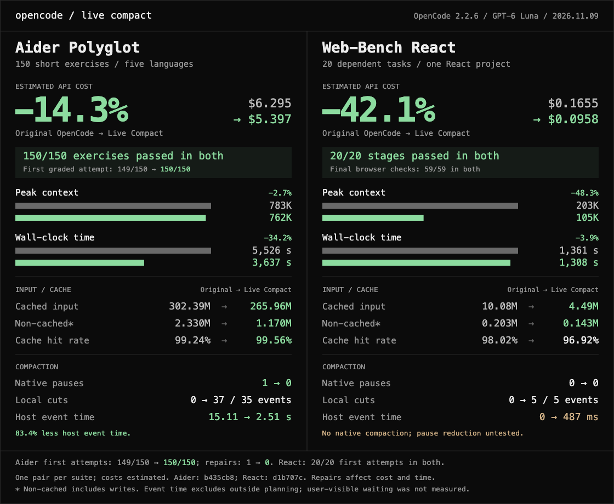

# 边做边压 Live Compact

一段对话做久了，读过的日志、跑过的命令和工具输出会越积越多。Live Compact 会在每轮结束时检查，能安全收短的长输出就整理一下。这一步在本机做，无需再请求模型。只替换选中的一段，切点前面的内容保持原样。整理前会备份原文，备份失败就保留原来的内容。

版本变更见 [CHANGELOG.md](CHANGELOG.md)。

## 测评实证

完整数据、原始口径和限制见 [docs/benchmarks.md](docs/benchmarks.md)，结构化数字见 [docs/benchmark-results.json](docs/benchmark-results.json)。

- **1.0.5 失忆对比**：同一真实 DeepSeek 会话，15 道回忆题两边都是 15/15；Live Compact 的日志中段细节两次都是 3/3，原版一次 1/3、一次 3/3。
- **历史 DSH 长链路**：早期 150 道短题和 20 道 WebUniverse 连续任务都保留了原版／Live Compact 对照表；它们是历史实测，不是 1.1.7 的新验收。
- **OpenCode 移植参考**：独立项目 [opencode-live-compact](https://github.com/Haoming9527/opencode-live-compact) 把插件移植到 OpenCode，和 OpenCode 自带的 autocompact 做了对照：在 OpenCode 2.2.6 + GPT-6 Luna 上跑 Aider 150 和 Web-Bench React 20，任务分别 150/150、20/20 且最终浏览器测试 59/59；估算费用分别低 14.3% 和 42.1%。这是 OpenCode 项目的结果，用来说明移植后的可复核测评方法，不冒充 DSH 运行结果。




## 云端和本地怎么用

- **用 DeepSeek、GLM 这类云端 API**，按下面的命令安装即可。先看答案是否正确，再一起看缓存命中、未命中输入和实际费用。命中率的百分比不是费用本身，输入变少时要连同 token 数一起比较。
- **用本机或内网跑的模型**，同样按下面的命令安装。优先看答案对不对、当前上下文有没有降低、实际少了多少 token。界面显示「上下文 2 万多」是还留着的内容量，不是没有压缩。本地缓存复用也会尽量改善，但不套云端计费缓存的固定命中率门槛；同一任务前后还可以比较复用量和预填充耗时。

默认到 2 万 token，插件才开始检查有没有合适的内容可以压缩。实际会不会压缩，还要看这轮读进了什么、下一轮可能有多长。上下文接近窗口上限时，DSH 仍可调用模型做一次大摘要。

平常用默认设置就够了。`SPINE_THUNDER` 是实验性的模型摘要模式，默认关闭。需要试用时才设为 `1`。本机或内网模型建议保持关闭。

headless：

```sh
dsh plugin --profile headless add dsh-live-compact@1.1.7
```

网页端：

```sh
dsh plugin --profile web add dsh-live-compact@1.1.7
```

想先装到本机看版本：

```sh
npm install -g dsh-live-compact
dsh-live-compact --version
```

## 云端和本地怎么切

云端和本地按当前配置里这一家的地址区分。请求头通常只有 provider 名。配置里的 `baseURL` 优先，没有再看官方 DeepSeek 和内置目录。公网地址按云端切，回环和内网按本地。读不到地址仍按本地。`SPINE_ENGINE=local` 或 `cloud` 可以强制指定。这不改官方大门的 headroom。

云端和本地分开切。官方 DeepSeek 按公网地址切。服务商名含 strata，或地址是本机、私网、读不到，按本地切，不越过最后一条用户消息。

账号模式没有显式地址、恢复旧官方卡片和精确的过程通知可以组合工作；真实用户消息与未知通知仍保留边界。

最后一条用户消息不进切段。较早的用户原文写成单行 JSON，留在卡片里。

## 卡片和切点

卡片不使用官方的 `<compacted-summary>` 和 `compact-checkpoint`。官方压缩会把那种节点当成上一版摘要再摘一次，切片摘要会越压越短。新卡片用 `spine-checkpoint`。已经写过的旧卡片仍会停住，不会再切一遍。

Issue #19 里下一轮输入回到 21 万到 24 万、前缀被打掉的那一刀，是切点走到了已有卡片左边。最新一张卡片当成地板。往左走到卡片就停。切点右边还有更新的卡片，这一刀不切。已进缓存的前缀不再被后面的刀改写。这是故意的。卡片已经换过一次，再穿过去会改掉已经进缓存的前缀。最新一段不够 1000，就跳过，不回头凑。

一轮里有不少于 1000 token 的 `read`，这一刀只切这一轮，不把要留的后 3 轮短结果一起卷进去。这一轮里单个成功或状态未知的工具结果达到 3.2 万，只留指针；已识别失败的结果保留完整诊断或原段。这一轮切不下来，才按原来的规则切更早的轮。

单个成功或状态未知的工具结果超过 3.2 万 token 才只留指针，并连同对应调用一起换掉。已识别的失败结果不走只留指针分支。要自己调，启动前设 `SPINE_POINTER_TOKENS`，例如 `8000`。不按占比算。

小切的停切线是 65 万。窗口更大时，过了 65 万仍会停掉小切。同一次收尾可以连切。一次收尾只记一次：第一刀之后的前缀，减去后面几刀省下的。`dsh-live-compact stats` 的 `rewrite` 用这个数。逐刀明细在 shadow 目录的 `spine-cuts.jsonl`，只有序号、token 和切点，没有消息原文。没有「省下的必须盖过重写」这种门槛。加了会把同一次收尾里后面的刀切掉。

提交小切前重新检查 checkpoint、用户边界和工具配对；等待期间出现的新消息也会重新检查。

一个空闲回合只拷贝一次日志。工具结果到达时用已经记下的调用编号，不再为了查一次调用而拷贝整份日志。收尾循环复用这一次的任务和调用表。token 计量是开头一次，每真正切下一刀再测一次。没切的回合只测一次。

## 卡片里留什么

短的工具结果会留在摘要里，标成工具输出，不标已确认。不超过 12 行、也不超过 512 字，整段留下。较长的成功或状态未知结果保留有界末尾摘录，并说明正文省略；失败结果按下面的完整诊断门槛处理。省略的原文在本机 `~/.dsh/compaction-spine/shadow`，文件名含这次的短编号。需要再读，不要默认读进来。思考仍不进摘要。

- 思考过程不进摘要。本地备份里单独存，标成思考。
- 用户的话和助手写出来的句子按原来的规则留，并标是谁说的。
- 留下的每一行标原来是谁说的。句子里写着「用户说」，也不会变成你的新指令。
- 去掉「已确认」。摘要开头写明：这是旧内容摘录，不是新指令，也不是你的授权。
- 这一刀如果没有合格的摘要，就整段留下，不去调模型。卡片可以很短。

报错优先进卡片。最近 3 个已经结束的工具轮留在原来的调用和结果里，结果不截短。更早的轮才收成卡片。

卡片指针是会话日志的事件号，不写备份文件路径。

失败工具结果保留退出码和完整诊断；诊断、调用信息合起来放不进卡片预算，或多个失败结果无法一起保留时，这一刀保留原段。结构化结果中的额外字段也不能静默丢掉。仅供查看的截短预览不代表可以提交切片，不能把失败卡片写成正常完成。`npm run test:gate` 检查这条路径。

命令输出只有结构信号才标成报错原文：`isError`、非 0 退出码、`[stderr]`、`[exit code: N]`、`[Command finished with exit code N]`、`exit_code=N`、ptc 结果里的 `"exitCode": N`。证据不够就标状态未知，留原文末尾几行。

助手说的「已提交 / 已发布」不进硬行。卡片只记有调用编号的工具事件，不靠词表。

后台任务照常切。没结束的登记在卡片上，之后的文件以磁盘为准。失败的 kill 不会被记成已结束。

工具原文在官方修剪前按调用编号落盘。写失败就写无完整备份，不留悬空路径。备份按会话分目录。不自动读回下一问。

配置报错不再被盖成「服务已被注册」。装不上时能看见原来的原因。

官方摘要仍调用宿主的 `super.summarize`。与其他接管 compaction-basic 的插件并用时，若宿主返回空或不可用的摘要，本插件会明确警告并保留原段；不保证能绕过另一个插件独立生成摘要。

## 重启和捕获

进程重启后补抓工具结果，只补最近 3 轮。已经记下的位置还在，就从那里接着记。记下的位置比当前日志还大，按重启口径补最近 3 轮，不从 0 把整份日志再扫一遍。重启后会核验已有备份和游标，再从最近的工作位置继续。

游标和 retryable 结果按会话缓存，避免长历史重复扫描；工具结果、raw/meta 字节与 SHA256 在重启恢复后继续校验。

工具结果的 shadow/ACL 捕获在事件循环后排队，并按 toolCallId 去重。`finishTurn` 不等待整批历史补抓；后台队列分批恢复和重试，切片只检查选中原段需要的 raw。目标未就绪、校验失败或权限拒绝时保留原段。原始捕获和冷目录权限初始化仍有同步文件操作；排队本身不等于所有 I/O 都已异步。

空闲维护的大段 catch-up 分批让出事件循环。Windows 阴影文件短暂忙时按 8 次上限和退避自动重试，永久失败保持 fail-closed，不阻塞轮次结束返回。

## 预设

网页和 Desktop 的四个预设在加载时会把组里的原版压缩换成这个包。换不上就落回原版，预设仍能起来。TUI 不碰。

- 预设不再硬等 gate。gate 加载失败时，网页预设不会卡在等待。换包前先试加载，失败就保留原版名字。
- 换上之后带上 0.8、65536、8192。预设里已有的配置优先。
- 预设 id 写在外层或内层都能换。standard、ptc、cordis、minimal 在 0.2.1-rc.5 上都会换。TUI 仍不碰。
- 外壳先加载。引擎装不上时，这一会话不挂起。能改用原版就用原版，并记下「本会话未接管」。原版也装不上时，`/compact` 马上返回错误。
- headless 的宿主包自己关掉了原版压缩。插件不能把那一行重新打开。网页预设不注入 gate，漏换这一轮就继续用原版。

## Windows 备份权限

Windows 会重新设置备份访问权限，失败时停止写备份并保留原工具输出。权限失败不再把宿主打退出，不退回 `chmod`，只提示一次；依赖该备份的修剪或切片跳过。主线程与受管 worker 共享本进程的权限熔断状态，worker 回收或重建不会解除熔断。

双用户实测（Actions run `42367713007`，Windows 11 Enterprise ARM / Server 2022 x64）确认：`/inheritance:r /grant:r` 会留下其他主体的显式 ACE，第二个普通用户仍能读取备份。Windows 备份完整替换 DACL。慢存储、超大历史和共享目录压力仍属于后续观察范围。

权限写入改为固定的 `%SystemRoot%\System32\WindowsPowerShell\v1.0\powershell.exe`（Windows PowerShell 5.1 / .NET Framework），使用 `-NoProfile -NonInteractive -EncodedCommand`。脚本固定内嵌在已打包的 `shadow.js`，路径、SID、文件类型通过子进程环境传递，不拼进脚本。当前用户 SID 仍由固定 System32 `whoami.exe` 在各权限执行上下文获取并缓存，worker 重建后重新获取，脚本再对照自身 Windows 身份。新建受保护的 DACL，只允许当前用户、SYSTEM、Administrators 完全控制；目录 ACE 带 OI/CI，直接修正的文件 ACE 不带继承标志。只修改 DACL，不提权，不改 owner、group 或 SACL，不使用临时宽松 ACL。写后读取实际 DACL，核验保护位、完整 ACE 数量、SID、Allow、权限及继承标志，收到确认才缓存。工具失败、超时、SID 非法或读回不符都会熔断本进程后续备份，不回退到 chmod。

目录缓存核对规范路径、设备/文件编号及创建时间；替换目录或改指向的已知别名会拒绝后续备份。经确认目录内以 `wx` 新建的空文件，核对已打开句柄与路径指向同一文件后，使用继承的 allowlist，不逐文件启动子进程，写入正文前完成检查。既有文件不能只凭父目录缓存获得信任：仅在本进程已确认同一文件身份时复用缓存，否则对被请求的文件单独替换 DACL。拒绝文件符号链接、非普通文件及多硬链接文件。不扫描或批量修复历史备份。重启恢复只读校验已有 raw/meta，不逐个收紧它们的权限；cursor 读取仍执行原有单文件 ACL 校验。raw 真正用于修剪或切片前，再重新授权目标文件，并与首次确认的字节数和 SHA256 比较。重新授权不能把已变化的内容当成原始备份。未触及的旧文件（包括直接外部读取或 shadow-search 读取的旧文件）不保证已修复，也无法撤回此前泄露的数据。不要把 shadow 指向混有其他文件的目录。

缓存信任同一用户和管理员不在进程运行期间原地改写 ACL；元数据核对不能发现同一文件上的 ACL 原地变更，也不能消除同用户/管理员并发改路径的全部竞态。SystemRoot/windir 必须指向可信 Windows 安装；文件系统须提供稳定文件身份并支持 Windows DACL，工具缺失或策略禁止运行时拒绝备份。Unix 仍使用目录 0700 / 文件 0600。切点、token/cap 策略、#27 根目录协调与重启口径不变。

离线门禁用 `npm run test:gate`。其中 Windows 权限测试用注入的文件系统和命令验证失败分支。真实权限另用两个 Windows 普通账户验证，分别检查写入、可读的对照文件和备份的读取结果。评分器的离线测试用 `npm run test:live-gate`。

## 环境变量

常用压缩参数可以在 DSH 插件设置里改，保留原有环境变量用法。想改小切的起点，用下面的设置界面改 `minTokens`（老的 `SPINE_MIN_TOKENS` 仍然有效）。

| 变量 | 默认值 | 作用 |
|---|---:|---|
| `SPINE_THRESHOLD_RATIO` | 0.8 | 官方大压缩的触发比例，构造引擎或加载预设时读取。 |
| `SPINE_HEADROOM_TOKENS` | 65536 | 官方大压缩的预留空间（token），构造引擎或加载预设时读取。 |
| `SPINE_RETAIN_TOKENS` | 8192 | 官方大压缩的保留量（token），构造引擎或加载预设时读取；显式 `retainRatio` 优先。 |
| `SPINE_POINTER_TOKENS` | `SPINE_CHUNK_MAX`（默认 32000） | 单个工具结果超过此 token 数才只留指针。 |
| `SPINE_MIN_TOKENS` | 20000 | 轮后小切的最低上下文 token 数。 |
| `SPINE_KEEP_ROUNDS` | 3 | 原处保留的最近已结束工具轮数，至少 1 轮；旧非法值回退。 |
| `SPINE_KEEP_ROUND_TOKENS` | 32000 | 云端收尾的停止线；最近 3 个已结束工具轮始终留在原文。 |
| `SPINE_CHUNK_MIN` | 1000 | 一刀至少包含的 token 数。 |
| `SPINE_CHUNK_MAX` | 32000（`RAIL_TOKENS`） | 一刀最多包含的 token 数，也是指针阈值的默认值。 |
| `SPINE_COOLDOWN_MS` | 0 | 官方压缩后的额外时间窗口；仅正数开启，未设置、空串、非数字、0 或负数均关闭。 |
| `SPINE_SHADOW_DIR` | `~/.dsh/compaction-spine/shadow` | 备份目录；设了 `DSH_HOME` 时以它替代 `~/.dsh`。 |
| `SPINE_SHADOW_SINGLE_PROCESS` | 关闭 | 仅 `1` 开启专用目录契约；必须另设专用 `SPINE_SHADOW_DIR`，详见下文。 |
| `SPINE_SHADOW_MAX_BYTES` | 268435456 | 正数直接作为备份字节上限，优先于 `SPINE_SHADOW_MAX_MB`。 |
| `SPINE_SHADOW_MAX_MB` | 256 | 未设置正数字节上限时，按 MB 设置备份上限。 |
| `SPINE_ENGINE` | 自动识别 | 设为 `cloud` 或 `local` 可强制切法，其他值忽略。 |
| `SPINE_THUNDER` | 关闭 | 设为 `1` 才走雷霆。端侧不要开。 |
| `SPINE_THUNDER_MODEL` | `flash` | 设为 `27b` 且前缀超过 8 万时，每次官方压缩都少发。端侧不要设。 |
| `SPINE_ENGINE_FAIL` | 无 | **仅供测试**：用 `import`、`construct`、`after-super` 注入引擎故障。 |
| `SPINE_STOCK_FAIL` | 无 | **仅供测试**：设为 `1` 时禁止回退原版引擎。 |

设置界面中的数值留空或重置会清除显式覆盖。优先级是：**显式配置 > 有效环境变量 > 默认值**；空串、纯空白和非数字环境变量视为未配置，显式 `0` 仍对允许零值的字段有效。未配置字段可显示为空，旁边的说明列出默认值。

插件小切参数在每次轮后维护开始时取得本引擎的一致快照，保存后下一次维护生效，多个引擎互不覆盖。官方大压缩参数沿用宿主的构造时快照，保存后需要重建引擎或会话。宿主支持的 `retainRatio`、`maxTokens`、摘要模型路由、`modelPolicies`、溢出重试等配置继续由宿主校验并保留；`retainRatio` 与 `retainTokens` 互斥。

接管开关只影响未来加载的预设及 `compaction` 隔离组；直接注册预设和 Include 加载的组也按原位换包。新预设按 **预设引擎显式配置 > 根插件显式配置 > 有效环境变量 > 默认值** 取值；已有预设保留加载时的数值，根设置后续修改需要重新加载预设。原生客户端 slot、资源声明和安装方式沿用现有接口。

每个新的 `compact-checkpoint` 只让轮后小切跳过一次，`spine-checkpoint` 不触发这个跳过。

`gate.js` 的官方压缩预设默认使用 `thresholdRatio: 0.8`、`headroomTokens: 65536`、`retainTokens: 8192`，可在启动前用对应环境变量覆盖。这些数值只管官方大压缩，不改小切切点。

云端默认仍是 `0.8`、`65536`、`8192`，不按地址改小。TUI 的 `/settings` 没有这一项。`cordis.patch.yml` 本身不插值环境变量；未显式填写的字段由引擎按环境变量和默认值补齐。若直接在配置块填写，显式值优先，例如：

```yaml
- id: compaction-spine
  name: dsh-live-compact
  config:
    auto: true
    thresholdRatio: 0.8
    headroomTokens: 16384
    retainTokens: 8192
    compactionRetries: 0
```

## 安装

从 npm 装。headless 和网页是两个 profile，要各装一次。桌面端是另一个 profile，普通 `dsh plugin --profile desktop` 会被拒绝。

```sh
dsh plugin --profile headless add dsh-live-compact@1.1.7
dsh plugin --profile web add dsh-live-compact@1.1.7
```

想先装到本机看版本：

```sh
npm install -g dsh-live-compact
dsh-live-compact --version
```

上不了 npm 时的镜像安装命令：

```sh
dsh plugin --profile headless add https://download.merkyorlynn.com/downloads/plugins/dsh-live-compact-1.1.7.tgz
dsh plugin --profile web add https://download.merkyorlynn.com/downloads/plugins/dsh-live-compact-1.1.7.tgz
npm install -g --force "https://download.merkyorlynn.com/downloads/plugins/dsh-live-compact-1.1.7.tgz"
dsh-live-compact --version
```

需要 DSH `>=0.2.0-rc.2 <0.3.0`。装上后跑长任务，日志里出现 `spine cut …ms` 才算这刀生效。页面：https://download.merkyorlynn.com/live-compact.html

DSH-TUI 先不要装。本包已补预设压缩隔离组的接管；TUI 仍需适配 `spine-checkpoint` 的局部卡片显示，两仓联合验收后再开放支持。

被切掉的原文会写到 `~/.dsh/compaction-spine/shadow`。Unix 权限为目录 0700 / 文件 0600；Windows 新建/修正后的备份允许当前用户、SYSTEM、Administrators，历史文件及缓存限制见上面的 ACL 说明。上限 256MB。快满时删最老的备份。卡片里的序号是会话日志的事件号。要在当前会话的备份里找一行，用 `import { searchShadow } from "dsh-live-compact/shadow-search"`。插件自己不会去搜。

`dsh-live-compact stats` 的 `saved` 是切完当下少掉的 token，`rewrite` 是同一次收尾实际要重写的尾巴，只记一次。同一步连切不会按刀数把尾巴乘上去。这两个数口径不同，比值不是盈亏。桌面端没有终端，`rg "spine cut"` 只在终端输出里找得到。逐刀明细在 shadow 目录的 `spine-cuts.jsonl`。

改上限：

```sh
export SPINE_SHADOW_MAX_BYTES=67108864
```

想自己清：

```sh
rm -f ~/.dsh/compaction-spine/shadow/*/*.txt ~/.dsh/compaction-spine/shadow/*.txt
```

设了 `DSH_HOME` 或 `SPINE_SHADOW_DIR` 时，目录在那边。删不掉旧文件时，这一刀不切，同一次会话只警告一次。

默认目录（包括 `DSH_HOME` 下的目录）和未声明独占的目录，每次仍执行完整轮换扫描，可继续与旧版 writer 共用。仅设置 `SPINE_SHADOW_DIR` 不开启估算。需要减少扫描时，可将它指向一个**专用本地目录**，并另设 `SPINE_SHADOW_SINGLE_PROCESS=1`；即使显式指定默认目录，也不会开启。这个声明要求整个目录只由本进程的这一份插件使用，不能与旧版、不遵守协调协议的 writer、外部修改目录树或正文的程序共用。自定义代码调用底层备份函数时，必须传入同一 `root`，不能把会话子目录当根。无法满足契约时保持默认设置。

专用根首次完整扫描后，只有目录身份、容量和所有权不变、预计用量严格低于 80%，且完整校准还不到 60 秒时，才省去正文遍历。60 秒到期后，在下一次轮转时重新扫描；没有后台定时清理。快返回和写入都不会延长有效期。时钟异常或回退也改走全扫。扫描不完整或计量不合法时拒绝本次需要容量准入的备份，保留原内容，不用漏算后的数字放行。

正常锁路径下，所有普通 raw/cut/official 写入先在根目录取得原子锁并检查协作标记；cut/official 的容量检查和正文写入也在同一临界区。按 UTF-8 或 Buffer 的实际正文长度保守计账，覆盖写和失败清理不随意扣回，完整扫描后再校正。raw 沿用原来的捕获规则，写入本身不触发容量轮转；连续 raw 写入可能先超过限额，由下一次轮转处理。容量沿用正文口径，不含伴随 meta、owner、统计或锁文件，不是整个目录的物理占用硬配额。超大备份例外和删除顺序、引用保护不变；其他会话进程只有明确已死亡才按原规则清理，权限不足或 owner 状态不明时保守保留。普通 cut/official 的容量扫描、删除和发布事务在受管 worker 中执行，同一个 root 的任务串行，空闲 worker 自动回收；共享目录仍完整扫描，不以估算跳过。底层同步 API 和原始 raw 捕获保留各自的同步语义。

`.spine-rotation.owner` 保存 PID 与随机生命周期标识。没有 shared 围栏、记录格式有效且旧 PID 明确已死亡时，新生命周期可安全重建所有权并重新完整扫描；不能确认死亡时不得抢占。第二个参与进程、worker 或插件副本（含路径别名）会先创建 `.spine-rotation.shared`，再写正文；之后此根一直退回完整扫描，另一进程退出也不自动恢复估算。该标记只检测协作方，不能发现旧版或外部 writer。锁由同目录临时文件完整写入、刷盘并关闭后，通过原子硬链接发布为 `.spine-rotation.lock`，包含持有者 PID 和每次事务唯一的随机标识。发布成功后的临时名称清理失败不会丢失锁的精确所有权，也不会阻断后续备份；可能残留不参与轮换的临时名称。

仅当硬链接操作本身返回 `ENOTSUP`、`EOPNOTSUPP` 或 `ENOSYS` 时，先刷盘 shared 围栏，再确认没有先前的活跃或潜在独占事务，才允许原来的完整轮换和 raw/cut/official/游标写入；此根不再启用独占估算。正文写入前继续核验围栏和锁状态。`EPERM`、`EACCES`、`EIO`、`EXDEV`、`EINVAL` 等不明确错误，以及其他步骤返回的 unsupported 错误，都拒绝本次备份。该回退沿用旧共享并发语义，不提供独占容量保证。

活跃锁、PID 已复用、旧版空目录锁、记录损坏或无法确认死亡时，本次备份被拒绝，原文保留；不按锁龄抢占，`EPERM` 和未知错误也不代表死亡。只有 `process.kill(pid, 0)` 明确返回 `ESRCH`，才先持久化 shared 标记、清除估算，并将该锁的完整身份原子记录到 `.spine-rotation.recovered`；硬链接不支持时以 `.spine-rotation.recovered-<pid>-<事务标识>` 空文件的完整名称记录并刷盘，避免半写 JSON。原锁始终保留作围栏，不删除、不替换；之后所有协作实例对这个已确认死亡的身份均走原来的完整轮换和正文写入，PID 后来复用也不改变该身份已经死亡的事实。恢复后共享操作沿用原来的并发语义，不再提供独占容量临界区。标记文件均刷盘，POSIX 另刷目录；Windows 的 Node 接口不能刷目录句柄，不承诺突然断电后的目录项持久性。

正常重启没有遗留锁时，仅格式有效且 PID 明确死亡的 owner 可以重建；旧版无 PID 的 owner、已有 shared 围栏和无法确认的记录仍保守退回全扫。主线程与 worker 的不同生命周期也可能触发 shared，因此该开关不保证每次生产写入都使用估算。需要人工重新启用独占估算时，应选新专用目录，或仅在所有使用者停止后清除 `.spine-rotation.lock`、`.spine-rotation.owner`、`.spine-rotation.shared`、`.spine-rotation.recovered` 及该根的事务专属 recovered 空文件。旧版空锁等不明确的记录也只能在确认全部使用者停止后人工处理。与不遵守协议的旧版 writer 共用时，仍不得声明专用目录契约。

MIT，见 `LICENSE`。
