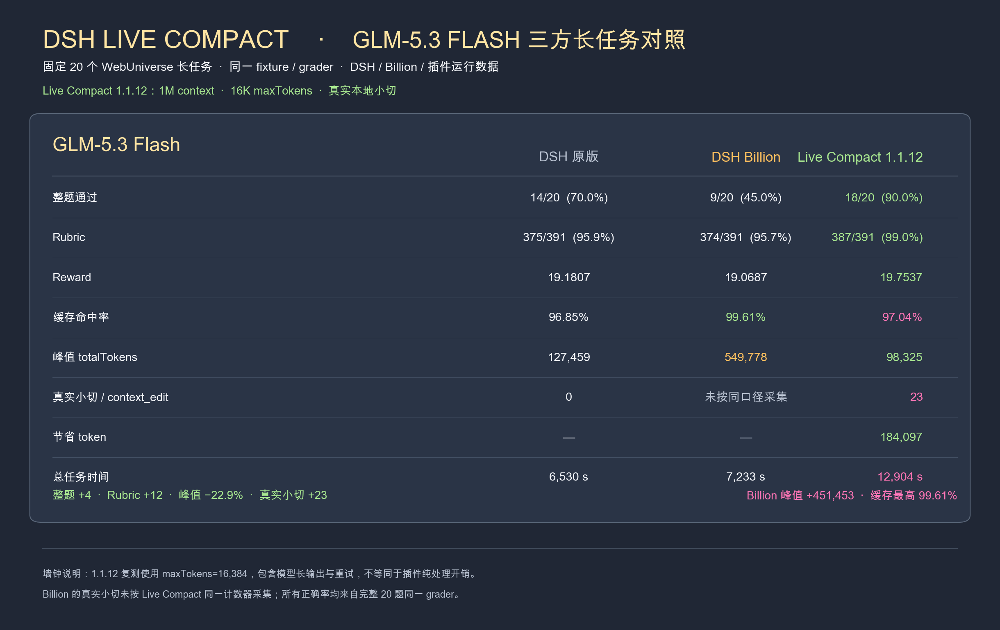

# DSH 三方长任务对照 · GLM-5.3 Flash · 1.1.12

固定同一批 20 个 WebUniverse 长任务、同一题序和 verifier，对照 DSH 原版、DSH Billion 与 Live Compact 1.1.12。结构化数据见 [`benchmark-dsh-three-way-glm53-1.1.12-2026-11-17.json`](benchmark-dsh-three-way-glm53-1.1.12-2026-11-17.json)，图见 [`benchmark-dsh-three-way-glm53-1.1.12-2026-11-17.png`](benchmark-dsh-three-way-glm53-1.1.12-2026-11-17.png)。

## 总表

| 指标 | DSH 原版 | DSH Billion | Live Compact 1.1.12 + GLM |
|---|---:|---:|---:|
| 整题通过 | 14/20（70.0%） | 9/20（45.0%） | **18/20（90.0%）** |
| Rubric | 375/391（95.9%） | 374/391（95.7%） | **387/391（99.0%）** |
| Reward | 19.1807 | 19.0687 | **19.7537** |
| 缓存命中率 | 96.85% | **99.61%** | 97.04% |
| 峰值 totalTokens | 127,459 | 549,778 | **98,325** |
| 真实小切 / context_edit | 0 | 未按同口径采集 | **23** |
| 节省 token | — | — | **184,097** |
| 总任务时间 | 6,530 秒 | 7,233 秒 | 12,904 秒 |

## 结论

Live Compact 1.1.12 + GLM 在这组固定任务中整题通过、Rubric 和 Reward 最高，峰值上下文比 DSH 原版低 22.9%，比 Billion 低 82.1%，并产生 23 次真实本地小切。Billion 的缓存命中率最高，但峰值上下文达到约 55 万 token；其小切没有用 Live Compact 同一计数器采集。

1.1.12 这一轮使用 `maxTokens=16,384`。总墙钟包含模型长输出和重试时间，不能直接解释成插件纯处理开销；它用于说明完整端到端运行时间。

逐题 GLM 结果保存在 JSON 的 `taskRows` 中，包含每题 verifier、reward、wall clock、token usage、peak 和真实小切增量。门禁证据：`test:gate` 604/604，`test:compat41` 22/22。
