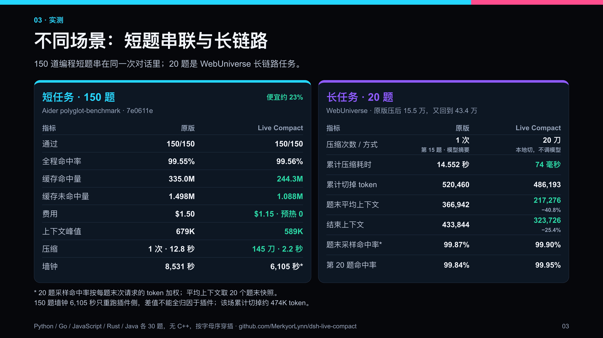

# 测评实证与数据口径

这里保留两类资料：仓库自己的历史实测，以及一个独立的 OpenCode 移植项目公开的对照结果。两类数据的宿主、模型、任务和版本不同，不能合并成一张“本项目总成绩表”。

## 先看结论

- **1.0.5 失忆对比**：同一会话埋入 13 条约束和 1 条报错，再灌入 6 轮日志，最后禁止读文件、只凭记忆回答。两边 15 道回忆题都为 15/15；Live Compact 在日志中段细节回忆上两次都是 3/3，原版一次 1/3、一次 3/3，后一轮依靠解压会话日志并多调用了 10 次工具。
- **早期长链路实测**：150 道 Aider 风格短题和 20 道 WebUniverse 长任务都记录过原版与 Live Compact 对照；详情、版本和限制见下文。
- **OpenCode 独立对照**：`Haoming9527/opencode-live-compact` 在 OpenCode 2.2.6 + GPT-6 Luna 上，用同一协议跑了 Aider 150 和 Web-Bench React 20。两组任务都完成，估算费用分别低 14.3% 和 42.1%；这是 OpenCode 项目的结果，作为可复核的移植案例引用，不冒充 DSH 运行结果。

## DSH Live Compact 历史实测

### 1.0.5 失忆对比

这是一次小样本方向性测试，不是通用记忆能力评测。环境是同一真实 DeepSeek 会话；先写入 13 条约束和 1 条报错，再灌入 6 轮日志，最后要求模型不读文件、凭上下文作答。每组跑 2 次。

| 指标 | 原版 | Live Compact |
|---|---|---|
| 15 道回忆题 | 15/15、15/15 | 15/15、15/15 |
| 违反约束 | 1 次轻微、0 次 | 0 次、0 次 |
| 日志中段 3 个细节 | 1/3；另一次 3/3，但解压会话日志并多 10 次工具调用 | 3/3、3/3，按需查自己的备份 |
| 每次请求上下文 | 约 15K | 约 29K |

两边都没有忘掉用户明确写下的约束。差异集中在工具输出里的细节；这组结果只能说明“保留原文并可回读”在该场景有帮助，不能推出所有任务都不会失忆。原版测试还特意把摘要阈值调低，以确保回忆前发生过摘要。

### 早期 150 题与 20 题对照

这两场是在 1.0.2 之前的早期版本完成的，1.0.2 没有重跑它们。它们保留在这里作为历史证据，不作为 1.1.5 的新鲜验收。

#### 150 道短题

任务是 Aider `polyglot-benchmark` 的选定子集：Python、Go、JavaScript、Rust、Java 各 30 题，没有 C++，按字母序穿插；固定提交 `7e0611e`。

| 指标 | 原版 | Live Compact |
|---|---:|---:|
| 通过 | 150/150 | 150/150 |
| 全程命中率 | 99.55% | 99.56% |
| 缓存命中 | 335.0M | 244.3M |
| 缓存未命中 | 1.498M | 1.088M |
| 估算费用 | $1.50 | $1.15，预热 0 |
| 上下文峰值 | 679K | 589K |
| 压缩 | 1 次、12.8 秒 | 145 刀、2.2 秒 |
| 墙钟 | 8,531 秒 | 6,105 秒 |

这组数据里 Live Compact 估算费用约低 23%，累计切掉约 474K token。插件侧 6,105 秒的墙钟只重跑了插件一侧，差值不能全部归因于插件。

#### 20 道 WebUniverse 长任务

这是另一条连续会话，不能和上面的 150 题相加。

| 指标 | 原版 | Live Compact |
|---|---:|---:|
| 第 15 题压缩 | 1 次模型摘要、14.552 秒、切掉 520,460 | 本地切，不调模型 |
| 题末平均上下文 | 366,942 | 217,276（低 40.8%） |
| 第 20 题结束上下文 | 433,844 | 323,726（低 25.4%） |
| 全程压缩耗时 | 14,552 毫秒 | 74 毫秒 |
| 题末采样命中率 | 99.87% | 99.90% |
| 第 20 题那一跳 | 99.84% | 99.95% |

采样命中率按每题末次请求的 token 加权，平均上下文取 20 个题末快照。原版第 15 题压缩后上下文一度降到约 15.5 万，结束时又回到 43.4 万；Live Compact 的 20 次切片都在本地完成。

### 其他历史回归

- **1.0.6 长填日志**：8 组、184 个填日志回合，WARN 184/184、NOTICE 184/184、假 NOTICE 0，8/8 会话都切过，共 17 刀。随后同题官方压缩对照中，插件估算 $0.211、原版 $0.229；这不是账单。
- **1.0.8 长填日志**：同一套 8 组、184 回合，WARN/NOTICE 均 184/184，缓存命中 98.23%；1.0.6 为 97.88%，原版为 98.51%。
- **Coder 390 27B**：独立的本地模型回归，3 组 31 轮，填日志 69/69，切掉 20,635 token。它不是上面的 Aider/WebUniverse 对照，也不是本次 QQ 反馈的来源。

这些历史数据的原始叙述和版本时间线仍保留在 [`CHANGELOG.md`](../CHANGELOG.md)；本页只是按测评类型重新索引，避免 README 把不同版本混成一场测试。

## OpenCode 移植的公开对照

来源项目：[Haoming9527/opencode-live-compact](https://github.com/Haoming9527/opencode-live-compact)。它公开了原始结果、哈希、离线校验脚本和逐项 README：

- [Aider Polyglot 150 的结果与协议](https://github.com/Haoming9527/opencode-live-compact/blob/main/benchmarks/results/2026-11-09-aider-150/README.md)
- [Web-Bench React 20 的结果与协议](https://github.com/Haoming9527/opencode-live-compact/blob/main/benchmarks/results/2026-11-09-webbench-react-20/README.md)

两组都使用 stock OpenCode 2.2.6、GPT-6 Luna、独立 profile、单次连续会话和固定任务顺序，日期为 2026-11-09。每组只有一对对照，费用是用量估算，不是供应商账单。

### Aider Polyglot 150

| 指标 | Original OpenCode | Live Compact |
|---|---:|---:|
| 通过 | 150/150 | 150/150 |
| 全程缓存命中率 | 99.24% | 99.56% |
| 非缓存输入 | 2.330M | 1.170M |
| 估算 API 费用 | $6.295 | $5.397（低 14.3%） |
| 上下文峰值 | 783K | 762K |
| 压缩 | 1 次、15.11 秒 | 37 cuts、2.51 秒 host event time |
| 墙钟 | 5,526 秒 | 3,637 秒 |

原版首轮 149/150，修复 1 题后达到 150/150；Live Compact 首轮 150/150、无修复。该差异会影响费用和墙钟，不能把全部差距归因给插件。

### Web-Bench React 20

| 指标 | Original OpenCode | Live Compact |
|---|---:|---:|
| 阶段通过 | 20/20 | 20/20 |
| 最终浏览器测试 | 59/59 | 59/59 |
| 估算 API 费用 | $0.1655 | $0.0958（低 42.1%） |
| 缓存命中率 | 98.02% | 96.92% |
| 上下文峰值 | 202,924 | 104,970 |
| 原生暂停 | 0 | 0 |
| 本地切片 | 0 | 5 |
| host event time | 0 | 487 毫秒 |
| 墙钟 | 1,361 秒 | 1,308 秒 |

这组两边都没有触发原生压缩，因此“减少原生暂停”的收益没有被测到；Aider 和 Web-Bench 的缓存、上下文、费用指标也不能互相替代。

## 怎么读这些数字

1. 正确性先于压缩量：通过率、首轮修复和最终测试必须一起看。
2. 缓存命中率不是费用本身；还要看缓存写入、非缓存输入、上下文峰值和实际请求数。
3. 墙钟和 host event time 不是同一件事；本地切片可能与宿主事件重叠，不能简单相加或全归因给插件。
4. 这些是受控对照，不是所有模型、宿主、QQ 插件或本地推理后端的保证。1.1.5 的 Windows/长会话验收另见 [`release-1.1.5-verification.json`](release-1.1.5-verification.json)。

